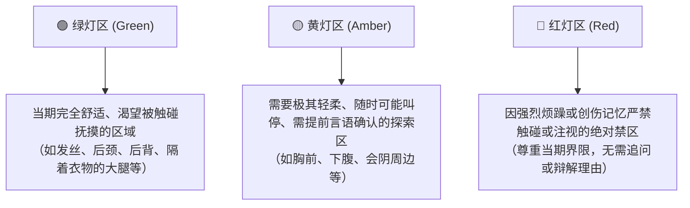

  <strong>简体中文</strong> | <a href="README_en.md">English</a>

  

# 温热的拥抱：跨性别女性非纳入式亲密与身体探索经验汇编
> ——以体表相温、柔和自慰与股间亲密（Intercrural Sex）为探索样本

> **文档性质**：个人经验驱动的社群讨论与非纳入式亲密经验汇编（Community-sourced, Experience-based Informational Document）  \
> **整理背景**：由跨性别女性基于自身探索、亲历体会，系统梳理英语跨性别社群（主要是 Reddit 的 r/MtF、r/mypartneristrans 等板块）的公开讨论，并结合现代酷儿性教育文献（如《Girl Sex 101》等）与性学医学指南整理而成。旨在为华语姐妹引介前沿、自尊且多元的身体探索经验。  \
> **核心宗旨与受众谱系**：扎根于跨性别女性的切身体会与真实探索，面向处于不同身体与医疗阶段的跨性别女性——无论你是**决定不进行生殖器手术（Non-op）**、**处于未术或筹备手术阶段（Pre-op）**，还是**已完成性别重塑手术（Post-op）**；无论你是否接受性别肯定激素治疗（GAHT/HRT）。亲密的权利与女性身份完整自足，不以任何特定的医疗步骤为先决条件；同时也为任何渴望摆脱单一剧本、拓宽亲密想象的人提供一片温暖平行的参考空间。  \
> **核心范畴**：以广义的 **非纳入式性亲密** (Outercourse) 为全景视域，涵盖体表抚摩、正念感知、自慰手法与玩具应用；同时，鉴于 **股间亲密** (Intercrural Sex，即大腿间亲密/腿交) 在社群交流中极高的讨论频次与独特的包覆感，正文与案例对该形式给予了深度的机制剖析、心理调适与安全护理总结。
>
> **重要声明与局限性披露**：
>
> 1. **非医疗与临床指导**：本文不是经过同行评议的临床医疗指南，亦不构成医学、内分泌或专业心理治疗建议。涉及激素调整、身体疼痛、感染、严重性别烦躁或术后并发症时，请务必咨询具有跨性别友好资质的执业医师与心理咨询师。
> 2. **样本来源与检索偏差**：文中社群经验主要来源于 Reddit 等海外论坛的关键词检索（如 *intercrural*, *thigh sex*, *outercourse*, *trans clit*, *grinding* 等）。此方法天然存在选择性偏差（更倾向于收录对非纳入式亲密有特定探讨或正面反馈的用户），不代表全体跨性别女性的普遍现状，亦不构成统计学意义上的性行为全景调研。
> 3. **个体差异的绝对尊重**：每位跨性别女性的身体构造、激素响应、感知敏感带、性取向及心理边界均高度独特。任何亲密形态都仅作为平行探索选项，**无需通过任何特定的性行为来证明自己的性别认同或女性身份**。

---

## 目录

1. [一、 拓宽亲密想象：非纳入式（Outercourse）与体表亲密的广泛实践](#一-拓宽亲密想象非纳入式outercourse与体表亲密的广泛实践)
2. [二、 生理基础、神经同源与感知重塑：身体如何体会愉悦](#二-生理基础神经同源与感知重塑身体如何体会愉悦)
3. [三、 心理调适与减负：身体烦躁缓冲、观审现象与正念亲密](#三-心理调适与减负身体烦躁缓冲观审现象与正念亲密)
4. [四、 社群实践经验：探索多元手部技巧、自慰与亲密方式](#四-社群实践经验探索多元手部技巧自慰与亲密方式)
5. [五、 多元伴侣情境、双向沟通与身体边界地图](#五-多元伴侣情境双向沟通与身体边界地图)
6. [六、 生理安全、前沿感染防护与皮肤护理（重要）](#六-生理安全前沿感染防护与皮肤护理重要)
7. [七、 结语：回归自主与舒适的身体探索](#七-结语回归自主与舒适的身体探索)
8. [八、 参考资料与经典文献指引](#八-参考资料与经典文献指引)

---

## 一、 拓宽亲密想象：非纳入式（Outercourse）与体表亲密的广泛实践

在主流的生殖中心主义叙事中，性常被窄化为“器官插入/纳入”（Intercourse）。这种既定剧本对于跨性别女性（Transfemme）而言，往往伴随着沉重的身心压力：决定不手术（Non-op）或尚未手术（Pre-op）的姐妹，常被外界或伴侣默认套用顺性别男性的模式，又或者被局限于后庭接纳的单一想象中；而已完成手术（Post-op）的姐妹，在日常扩张疲劳期或黏膜脆弱阶段，对于纳入式性行为同样面临客观的身体限制。

### 1. 广义的“非纳入式性亲密”（Outercourse）与股间亲密

在现代酷儿性教育与性健康学中，**非纳入式亲密** (Outercourse) 是一个宽广而自足的领域，指代所有不涉及将器官或硬质器具纳入体内腔道（如阴道、直肠）的亲密表达。它包括但不限于：

- 大面积皮肤贴合、拥抱、深吻与全身慢节奏抚摩；
- 手部抚触、正念触觉感知、体外玩具共振、身体部位相互研磨（Tribadism / Frottage / Grinding）；
- **股间亲密** (Intercrural Sex)：源自拉丁语 *inter* [在……之间] 与 *crura* [大腿]，即利用双腿内侧形成的自然夹角与温热阻尼进行贴合、滑动与节奏性摩擦。

股间亲密是非纳入式亲密图谱中的一个具体分支。在跨性别女性社群的长期交流中，它因具备独特的物理接触面积、温润包裹感以及视线回避特性，成为许多人安顿身心、探索身体边界时极具代表性的经验选项。

### 2. 性学调查与跨文化历史背景

非纳入式体表亲密绝非某种妥协性质的“代餐”，在人类性学史与多元文化中，它始终占据着核心生态位：

- **金赛团队的性学调查**：阿尔弗雷德·金赛（Alfred Kinsey）团队在《人类男性性行为》（1948）与《人类女性性行为》（1953）中，系统调查并记录了大腿间接触与体表研磨在不同性取向人群中的发生频率。金赛的研究客观表明，非纳入式体表摩擦长期稳定地存在于人类的性实践图谱中，具有深厚的情感亲密价值与相对安全性；
- **跨文化的体表相温**：在古希腊时期的瓶画与文献记载中，伴侣间的股间接触常作为一种克制且具仪式感的亲密表达；在东方传统文化（如“肌肤之亲”）及许多非生殖导向的亲密记录中，通过四肢、腿腹相贴进行温存也是舒缓放松的常见形式，展现了人类情欲表达的丰富弹性。

### 3. 多元社群中的非纳入实践

非纳入式的体表亲密在更广阔的性取向与性别光谱中，始终是客观存在且高度自足的亲密形式：

- **女同性恋社群中的相互研磨** (Tribadism / Scissoring)：长久以来是女性伴侣亲密中的核心形式之一，证实了非纳入式体表摩擦能支持完整的生理快感与深层的情感依恋，性爱无需以“长条状物体的插入”作为终局判定；
- **男同性恋社群中的“Side (侧位)”认同**：近年来在性学与社群中被广泛认可，指代在生理或心理上不偏好后庭纳入，专注于体表爱抚、股间亲密、深吻与手工互助的群体，生动打破了“同性爱必须模仿异性插入”的刻板偏见；
- **跨性别男性** (Transmasculine) 的体外探索：部分跨男伙伴由于长期使用睾酮导致黏膜干燥变薄，或出于对该解剖部位强烈的性别烦躁，同样倾向于使用大腿夹持义肢、体表研磨或衣物阻隔按压来获得满足释放；
- **现代酷儿性教育的赋权视角**：正如性教育家 Allison Moon 与跨性别学者 Tobi Hill-Meyer 在《Girl Sex 101》中所强调的：“人们常问跨性别女性‘你们究竟怎么做爱？’——答案是：以任何她们想要的方式。如果一对伴侣喜欢穿着内裤互相蹭蹭研磨（Grind）就能获得快乐，那就完全值得为之喝彩。”

### 4. 本文的基本立场：去层级化与平等的身体自决

腔道纳入式性爱、非纳入式体表研磨、口腔亲密或纯粹的情感触抚，在人格尊严与愉悦价值上是完全平等的。

这些方式既可以独立作为一场完整自足的亲密，也可以在一次互动中自由交织。亲密没有既定的线性流程脚本，核心始终在于彼此边界与意愿的知情确认。在社群现实中，**相当一部分跨女能在股间亲密与体表研磨中获得极大的包覆感与温存；也有人觉得刺激平淡、没有感觉，或因摩擦发热、姿势局促感到不适——所有这些感受都极其真实且正常**。如果你尝试后觉得不适合自己，随时可以放下并转向其他探索。

---

## 二、 生理基础、神经同源与感知重塑：身体如何体会愉悦

无论是否接受性别肯定激素治疗（GAHT，通常包括雌激素及抗雄药物，部分人辅助孕酮），跨性别女性的身体都拥有丰富的感知潜能。激素能够深刻重塑身体的反应模式，而即使在未接受激素治疗的情况下，通过改变抚触方式与神经激活焦点，同样能唤醒深层的身体共鸣。

### 1. 胚胎同源性与阴部神经分布（解剖学机制）

在胚胎发育学中，无论人类出生时被赋予何种生理性别指派，外生殖器区域均起源于相同的胚胎原基，并由**阴部神经（Pudendal Nerve）**系统进行同源神经支配：

- **同源映射关系**：
  - 生殖结节（Genital tubercle）发育为阴蒂头或阴茎龟头；
  - 尿生殖褶（Urogenital folds）发育为小阴唇或阴茎腹侧包皮及尿道海绵体；
  - 生殖隆起（Labioscrotal swellings）发育为大阴唇或阴囊；
  - 会阴正中缝（Perineal raphe）与阴囊缝在胚胎学上属于同一闭合线。
- **神经分支的触觉存留**：
  阴部神经分出的阴蒂/阴茎背神经（Dorsal nerve）、会阴神经（Perineal nerve）以及肛门直肠下神经（Inferior rectal nerve），在会阴体（Perineal body）及整条会阴缝周围构成了致密的神经网。
  - 在 GAHT 抑制睾酮、减少海绵体充血后，前端器官的机械性剧烈耐受度降低，而外阴根部到肛门之间的会阴带、阴囊正中缝浅层的微细神经末梢（如迈斯纳小体、游离神经末梢）依然高度活跃；
  - 适度的温热、大面积滑动阻尼或低频钝性压迫，能直接激活这些同源神经，诱发深层骨盆神经丛的弥散共振，带来不同于传统单点爆发的全新快感。

### 2. 脂肪分布、肌群控制与骨盆底健康（PFPT 视角的引入）

- **皮下脂肪的重塑**：女性化激素治疗通常促使皮下脂肪向臀部、髋部与大腿区域重新分布，大腿内侧组织往往变得更为丰满柔软，这为体表摩擦提供了天然柔软的减震介质；
- **内收肌群（Adductors）的自主控制**：大腿内侧肌群由骨骼肌构成，受自主意识调控。与依靠植物神经调节的内腔不同，双腿的夹紧、微张、滑动节奏完全掌握在当事人自己手中，提供了充分的主动权；
- **盆底肌高张力（Hypertonicity）与放松调节**：
  根据国际骨盆物理治疗学会（APTA / POGP）近年针对跨性别群体的临床指南，许多跨性别女性（无论是由于日常长期 Tucking 束缚、慢性身体烦躁诱发的紧绷，还是术后机械扩张刺激）容易出现**高张力性盆底功能障碍（High-Tone Pelvic Floor Dysfunction）**，表现为提肛肌持续痉挛、骨盆钝痛或亲密时难以放松。
  - *呼吸下调训练（Down-training）*：在进行非纳入式亲密或自慰时，配合**腹式深呼吸（Diaphragmatic Breathing）**——吸气时腹部隆起、意念引导骨盆底向下沉舒展，呼气时自然放松，能有效打破骨盆肌群的防御性痉挛，让快感更顺畅地传导至全身。

### 3. 胸部（Breast）的感知发育与性感带重塑

在 GAHT 过程中，乳房的发育（乳核萌发、腺体生长与脂肪沉积）是临床上最明确的身体特征之一，敏感带图谱随之深刻重绘：

- **姿势联动（以侧卧背拥为例）**：在体表亲密中，伴侣从后方拥抱时腾出的双手对前胸的轻柔抚按，与双腿内侧的温热研磨形成上下呼应的多点共鸣；
- **性别肯定与心理抚慰**：对于受困于原生下体烦躁（Bottom Dysphoria）的当事人，胸部提供了一个完全避开敏感部位、安全且具高度肯定感的快感中枢；
- *个体差异提示*：乳房发育速度及快感反馈各不相同。初生长期的触痛需要更轻柔的对待，探索应以当下舒适为准，无需将“必须产生强烈快感”作为心理包袱。

### 4. 感知图谱的泛化：从局部刺激到全身共鸣

在社群交流与《Girl Sex 101》等文献中，许多跨女常形容女性化内分泌主导下（或通过正念调适后）的体验具有更强的“全身性与弥散感”：

- **感知重心的转移**：性唤起往往不再局限于单一器官的快速充血与强刺激，而是转变为颈项、锁骨、前胸、后腰及大腿内侧等多处敏感带的共同唤醒；
- **多点联动与氛围沉浸**：大腿间的温和阻尼与摩擦，与伴侣的拥抱、呼吸交融以及耳畔低语交织在一起，形成持久深沉的情感共鸣。

**愉悦模式的并存与自主选择**：  \
局部聚焦的冲动与舒缓漫游的弥散感知，在人类身体中是天然并存的潜能。每个人都可以根据自己的真实舒适度、情感节律与心理防线，自主选择与深耕最契合自己的模式。

---

> ### 💬 场景探讨 ①：激素治疗初期的欲望变化与身体陌生感
>
> **【典型困扰与情境】**  \
> *“吃糖快半年了，睾酮压得很低。以前很强烈的欲望突然没了，用过去的手法不仅毫无快感，甚至觉得很不舒服和排斥。我很担心自己是不是彻底‘性冷淡’了……大腿间这种温和的体表摩擦，能对身体有感觉吗？”*
>
> **【社群探讨与经验归纳】**  \
> 梳理自 Reddit r/MtF 等社群的高频困惑：在 GAHT 早期，随着血清睾酮被有效抑制，许多当事人经历性冲动断崖式下降、原有自慰方式带来疼痛或反感，由此产生对“性冷淡”的焦虑。  \
> 亲历者指出，这通常是内分泌节律换轨期的常见生理过渡，而非永久性的性功能丧失。睾酮下降减少了自发性勃起和急迫冲动，表皮变薄也容易让高强度的快速套弄变得粗糙刺痛。此时将注意力转向全身性、慢节奏的接触（如背部拥抱、胸腹相温或双腿间的大面积温和摩擦）会舒适得多，既能避开对敏感器官的直接冲击，又能维持温润的触觉包裹。
>
> **【整理者建议与安全备忘】**  \
> 放下“必须快速达成高潮”的既定目标，允许身体在内分泌新节律下从容重新自我认知。若伴随持续严重的情绪低落、抑郁或身体异常乏力，建议咨询内分泌专科医师检测激素指标，或寻求跨性别友好的心理支持。

---

## 三、 心理调适与减负：身体烦躁缓冲、观审现象与正念亲密

在社群交流中，非纳入式亲密（尤其是股间亲密）的核心价值，往往在于它为当事人的心理防线提供了喘息空间。

### 1. 降低准备过程的身心耗竭（Prep Fatigue）

传统的后庭接纳通常伴随着严格的准备程序：饮食顾虑、灌肠清洁、放松扩张等。对于部分人群而言，这一繁琐流程容易让亲密行为变得像一项“医疗任务”，尚未开始便已耗尽兴致。非纳入式的体表亲密无需复杂的后庭清洁等准备，能够实现随时开始、随时暂停的低压力状态。

### 2. 视线安全与身体烦躁（Dysphoria）缓冲

对于具有强烈下体性别烦躁（Bottom Dysphoria）的未术与非术跨女，裸露直面原生器官容易诱发心理防御、焦虑甚至解离感：

- 股间亲密多采用侧卧或双腿并拢姿势，自然形成了遮蔽与折叠空间，使双方的视线焦点避开敏感区域；
- 当事人注意力更多集中在大腿轮廓、伴侣的拥抱体温及胸前接触上，有助于建立心理安全感；
- 结合贴身衣物或轻度收纳（Tucked）状态进行互动，可在触觉与视觉上构建温和的物理屏障。

### 3. 破除“观审现象（Spectatoring）”与自我客体化

在外界审视、社会评价与成人媒介的潜移默化下，许多人在亲密探索或与伴侣相拥时，脑海深处常宛如有一台苛刻的监视器在打量自己：挑剔自己的骨骼轮廓、体表线条或解剖部位，甚至不断考核自己的声音、姿态与反应是否符合某种合格的“性感客体”。

性心理学中将这种**在性活动中抽离出来、像第三方旁观者一样挑剔考核自己身体与表现**的心理防御机制称为 **观审现象（Spectatoring）**（最早由 Masters & Johnson 提出）。在跨性别女性身上，这种现象往往与性别烦躁、对身体是否“足够女性化/Pass”的焦虑重叠交织，演化为强烈的讨好冲动与“表演性消耗”。

**正念应对与身心着陆指引**：

- **觉察并贴标签（Noticing & Labeling）**：当脑海中跳出*“我的腿不够细/我的身体很怪/对方会不会觉得我在敷衍”*时，无需与之对抗，在心里温和地对自己说：*“看，脑海里的考官又来了，这是我的焦虑在试图保护我，但我现在很安全”*；
- **生理锚点（Anchor Points）**：将飘走的注意力重新锚定在**呼吸的气流起伏**或**伴侣手心的温度**这两个微小而坚实的物理感受上；
- **5-4-3-2-1 感官着陆法则（Grounding）**：若在亲密中突发严重解离或恐慌闪回，应立即暂停亲密，与伴侣一同执行感官着陆：
  - 看 5 样周围的具体物品（如台灯、枕头花纹）；
  - 摸 4 样不同质感的触合物（如粗糙毛毯、光滑床单、自己的掌心）；
  - 听 3 种环境声音（如窗外雨声、彼此的呼吸声）；
  - 闻 2 种气味（如枕头香气、伴侣体温）；
  - 尝 1 种味道（喝一口温水）。

### 4. 身体词汇的自我决定权（Julia Serano 的视角）

正如跨性别学者 Julia Serano 在《Girl Sex 101》中所强调的：**身份标签与身体词汇是描述性的（Descriptive），而不是规范性/强制性的（Prescriptive）**。

在亲密关系中，你拥有对自己身体各部位如何称呼的绝对决定权。你可以称呼自己的器官为“阴蒂”、“女孩小鸟（Girl-dick）”、“前置部位”，或者使用任何中立、抽象的昵称。伴侣间提前沟通彼此舒适的称谓，能从语言层面上彻底消除被错位性别称呼（Misgendering）引发的烦躁风险。

---

> ### 💬 场景探讨 ②：跨直女在伴侣关系中的愧疚与边界协商
>
> **【典型困扰与情境】**  \
> *“我很爱我男友，但我心理上和生理上都极度抗拒后庭纳入，试过一次疼得浑身发抖。每次看到他隐忍的样子，我就很内疚，觉得自己无法满足他。如果我提出用大腿夹着他亲热，他会不会觉得我只是在敷衍他？”*
>
> **【社群探讨与经验归纳】**  \
> 归纳自跨性别直女（与顺性别男性交往）在亲密沟通中的真实痛点：因生理剧痛或心理抗拒无法进行纳入式性行为，面对伴侣的隐忍产生深层自责，担心被认为“不够女人”或“在敷衍”。  \
> 在 r/mypartneristrans 等伴侣互助区，许多顺性别男性伴侣表示，比起“特定孔道的纳入”，亲密中他们最害怕的其实是“弄疼深爱的人”，双方往往同时承受着紧张与愧疚。大腿内侧配合高品质润滑剂能提供充足的温热包裹感与阻尼反馈。在彻底消除“担心女方撕裂或剧痛”的提心吊胆后，伴侣反而能以更放松的心态投入情感表达中，双方均能在安全边界内获得充实的满足。
>
> **【整理者建议与安全备忘】**  \
> 强忍剧痛与恐惧迎合伴侣会对身心造成二次创伤，也不利于建立长久信任。坦诚表达：“我很渴望与你亲近，但我的身体需要一种安全、无痛的交流语言。”真正的亲密是双方舒适区的交汇，而非单方面的牺牲。

---

## 四、 社群实践经验：探索多元手部技巧、自慰与亲密方式

以下手法整理自社群用户的长期交流分享与《Girl Sex 101》等现代性教育文献，供探索实践时参考：

### 1. 侧卧背拥式（Spooning Position）

- **形态与操作**：当事人背对伴侣侧卧，双腿微屈并拢；伴侣从后方自然贴合其臀部与背部，将身体适度送入两腿内侧根部之间；
- **经验优势**：
  - **深层体表触压**：后背的大面积紧密贴合提供了稳定的触觉输入，有助于平复交感神经兴奋；
  - **伴侣双手自由**：伴侣可自由抚摸前胸、颈项、脸颊或牵手，强化情感交流；
  - **天然视线回避**：双方均背向敏感区域，无需直面可能诱发烦躁的解剖结构。

### 2. 布料阻隔与收纳状态探索（Sex while Tucked）

- **操作方式**：亲密过程中保留柔软、平整、无硬接缝的贴身内裤（如真丝、超细莫代尔面料），亦可保持轻度的平腹收纳（Tucked）状态；
- **经验优势与心理肯定**：
  - 在视觉和触觉上建立物理屏障，有效降低因生殖器裸露触发的紧张感；
  - 保留收纳状态进行亲密，平整贴服的包裹感在心理上能赋予强烈的性别肯定（消除器官突出的形态违和感）；
  - 织物在吸收适量润滑剂后，能提供均匀顺滑的滑动介质，避免粗糙擦挂；
- **医学力学安全须知（避免腹股沟疝与精索扭伤）**：
  - 在进行股间研磨或剧烈身体活动时，**严禁使用高强度医用胶带进行强力胶带收纳（Tape Tucking）**；
  - 建议优先选用弹性适度的柔软平角内裤进行**浅层松弛收纳**，**避免在承受身体正面挤压或自重按压时将睾丸强行深推入腹股沟管内**。长期在高压下将睾丸推入腹股沟管容易扩张腹股沟浅环，增加腹股沟斜疝（Inguinal Hernia）和精索静脉回流受阻的风险。若感到下腹牵拉隐痛，应立即调整松解。

### 3. 重塑手部技巧与柔和抚触（参考《Girl Sex 101》的手法创新）

在激素作用或身心放松的状态下，原生器官的充血硬度与反应模式常会发生改变。传统生硬的“上下活塞式套弄”极易引起表皮擦伤或心理烦躁。《Girl Sex 101》与社群成员总结出了一系列更契合女性化感知的技巧：

- **“垒球折叠”法（The Softball Fold）**：
  若当期器官处于疲软或半充血状态，无需强求其坚挺。可顺着耻骨联合上方或腹股沟将其自然弯折平贴于下腹。这种折叠在视觉与触觉上创造了更紧凑、平整的轮廓，消除了“把握长条状物体”的旧有心理定式。此时，掌心与指腹隔着表皮对前端与整体组织进行大面积的打圈抚按、温和震颤或轻微拢揉，能将刺激转化为类似大面积阴蒂包覆区的温润快感；
- **“自行车座”感知与会阴钝压（The Bike Seat）**：
  在解剖同源性中，骨盆深层的海绵体组织与神经分支向后一直延伸至会阴底部。许多人发现，将掌根如自行车座一般稳稳抵在会阴区域（阴囊根部至肛门之间），配合深长呼吸给予持续平稳的钝性推压（亦可用拳头指节或膝盖温和顶住），能够诱发极为充实、具有扩散感的骨盆深层共振；
- **指间剪刀位（Safety Scissors）与轻捏基底**：
  伴侣可用食指与中指形成自然的“剪刀差”，从侧向轻柔环抱基底，配合充足润滑进行左右滑动研磨，而非纵向抽拉。

### 4. 振动设备的舒缓应用与双人夹持共鸣

宽幅大功率振动器（如 Magic Wand 等）常被视为探索身体、舒缓紧张的温和媒介：

- **俯卧垫枕舒缓法（Pillow Pressing）**：
  - *操作要领*：当事人俯卧在松软枕头上，私处平贴垫面。**建议在小腹与髂骨下方横垫一个扁平软枕**，使骨盆微微后倾，既能有效减轻腰椎前凸造成的腰酸，又能让会阴与振动头贴合得更加平实稳定；将宽大平缓的球头隔着柔软衣物平稳下压或轻置于背侧；
  - *体感反馈*：震波均匀分散至大腿内侧与骨盆底，消除操作原生器官带来的心理防线，带来持久深沉的全身性温存；
- **伴侣面对面“魔棒夹持研磨”（Wand Grinding，引自《Girl Sex 101》）**：
  - *操作要领*：伴侣双方采用面对面相拥依偎（如侧卧相抱或双腿轻柔交叠）的姿势，将振动器平置并夹在两人大腿根部与私处之间的接触面上；
  - *体感反馈*：振动器充当了传递体温与呼吸节律的桥梁，双方无需大幅度动作，便能在相拥轻抚与低语中共享平缓的体表共鸣。

### 5. 压迫感知：“夹腿”与玩偶研磨（Syntribation & Grinding）

在跨女社群交流中，“夹腿”或借助松软的枕头、被褥及毛绒玩偶进行体表研磨，是一种非常普遍且自然的身体探索习惯（性学中常称此类夹腿自慰为 **Syntribation**）。

它的特点在于脱离双手操作、无需注视身体。通过交叉双腿、收紧大腿内侧肌群，或趴卧借助自身重力贴合枕头，身体获得的是一种作用于会阴与骨盆底的深层钝性压迫感。注意调整姿势并配合腹式呼吸，避免长时间紧绷引起腰髋肌肉僵硬。

---

> ### 💬 场景探讨 ③：伴侣视角的操作细节与安全考量
>
> **【典型困扰与情境】**  \
> *“女友告诉我她不喜欢碰下面，希望尝试用大腿夹着我互动。我非常愿意配合，但我以前从没试过，操作上有什么特别容易踩雷的地方吗？我很怕自己用力过猛弄疼她。”*
>
> **【社群探讨与经验归纳】**  \
> 亲历伴侣总结了三条高频实操经验：
> 1. **润滑宁多勿少**：大腿表面积大、体温高，润滑剂干涸后极易擦伤娇嫩皮肤，充足且持久的润滑介质是基础；
> 2. **动作放缓、重视全身温存**：体表摩擦重在缓慢研磨与温存贴合，而非高频活塞冲撞，双手可自然环抱抚摸前胸与后颈；
> 3. **节奏交由当事人主导**：当事人通过大腿内收肌的自然收放调节松紧与幅度，伴侣顺应其呼吸节拍，并随时轻声确认体感。
>
> **【整理者建议与安全备忘】**  \
> 亲密前修剪指甲、摘除可能划伤皮肤的硬质饰品。双方可预先建立随时叫停的简单信号词，确保探索全程在放松、可控的前提下展开。

---

### 6. 术后跨女的亲密探索与阶段性休整选项

在完成性别肯定手术（SRS/GRS，包括阴茎皮瓣法、腹膜代阴道法、结肠代阴道法等术式）后，身体的解剖形态发生了重塑，亲密与自慰的探索维度也随之拓宽：

> [!WARNING]
> **术后早期绝对安全禁忌提示**：  \
> **在术后未完全愈合的早期康复阶段（通常为术后数月至半年内，具体必须严格遵照主刀医疗团队的出院医嘱），手术创面、外阴皮瓣、精细缝线及新生腔道结构极其脆弱。在此期间，任何剧烈的大腿收紧、夹持用力或会阴部位的摩擦，都存在拉扯切口、引发缝线裂开（Dehiscence）、皮瓣血运受损甚至皮下血肿的严重医疗风险**！  \
> 严禁在下体创口完全愈合前进行任何涉及大腿根部或会阴部的挤压与摩擦。

- **多维度的身体探索与自我愉悦**：
  - **腔道亲密与纳入探索**：在创口彻底愈合康复后，许多姐妹在伴侣互动中获得了满意、具肯定感的阴道纳入体验；
  - **外阴自慰与体表抚摩**：如针对阴蒂（由龟头神经血管束重塑而成）、大/小阴唇及尿道口周边的轻柔抚触、指腹打圈按压与小型振动器温和刺激；
  - **非纳入式亲密仍是完全自主的平行选项**：身体的愉悦不受制于解剖形态的变化。无论是否手术，大腿内侧温热的包裹与滑动研磨，始终是获得身体愉悦的正当选项；
- **长期扩张疲劳（Dilation Fatigue）与阶段性休整**：  \
  在漫长的术后维持期，长年累月的机械通条扩张容易让部分姐妹在心理上产生阶段性的防御与耗竭感。在组织完全健康的前提下，轻柔的大腿内侧贴合与非纳入式肌肤接触，方可作为一种不给新生腔道施加器质性压力的温存缓冲方式。

---

> ### 💬 场景探讨 ④：已术后的腔道扩张疲劳与心理落差
>
> **【典型困扰与情境】**  \
> *“做完手术已经大半年了，现在看到扩张通条就想吐。伴侣想和我亲热，但我一想到要深入就浑身紧绷、甚至偶尔有点渗血。辛辛苦苦做了手术，难道还要选择大腿间这种方式吗？我觉得很挫败。”*
>
> **【社群探讨与经验归纳】**  \
> 在已术跨女交流群中，“扩张疲劳（Dilation Fatigue）”是极为普遍的心理防御应激。机械扩张的反复刺痛易导致盆底肌发生保护性痉挛。  \
> 术后数年的姐妹反馈，在组织疲惫、干涩或情绪敏感期，大腿内侧与外阴周围的温柔贴合研磨，是一种非常安心的“避风港”；它不代表退步，而是身体在漫长重塑周期中多了一个不给伤口施压的温存选项。
>
> **【整理者建议与安全备忘】**  \
> 手术赋予的是自主选择身体形态的权利，而非必须随时接受纳入的枷锁。  \
> ⚠️ **关键医疗警示**：若扩张或接触中出现**持续渗血、组织撕裂、剧烈疼痛或异味分泌物**，**必须第一时间拍照并联络手术主刀团队或专科门诊排查**（排查肉芽组织增生、黏膜裂伤等并发症），严禁自行忍耐。

---

## 五、 多元伴侣情境、双向沟通与身体边界地图

### 1. 跨直女与男性伴侣

- **打破“非插入即不满足/缺乏雄风”的刻板印象**：传统文化常将男性的性能力与硬度、插入绑定。然而男性的兴奋点同样高度依赖于视觉、听觉、温热反馈与紧致阻尼。大腿内侧肌肉的紧致配合与伴侣的放松低吟，往往能给予男方强烈的身心回馈。引导伴侣将亲密视作“共同沉浸的感官游乐场”，而非考核个人征服感的考场；
- **双向减压**：当彻底消除了“担心造成女方撕裂或剧痛”的心理重负后，伴侣双方反而能以更松弛的心态投入情感连接。

### 2. 跨女同与酷儿伴侣（Trans-Sapphic & T4T）

- **去中心化的身体共振**：在女性与酷儿亲密模式中，股间亲密是相互研磨（Tribadism）与体表亲密的自然延伸，彻底打破了以“阴茎插入与射精”为终点的线性考核；
- **T4T 伴侣的现实挑战**：虽然跨性别女性双方共享相似的身份背景，但两人的激素进展、身体烦躁触发点及心理防御可能完全不同。界限沟通在 T4T 关系中同样至关重要，不能预设对方“理所当然知道我的边界”。

### 3. 实用沟通工具：身体边界“红黄绿灯地图（Traffic Light Boundaries）”

在亲密关系开始前，借助一套简单中立的视觉化语言，能极大降低沟通门槛与羞怯感：

- **动态变化原则**：红黄绿灯是随当天的身心状态、激素波动与疲惫程度动态浮动的。昨日的绿灯今日完全可以变为红灯，任何一方均无需为此感到抱歉。

---

> ### 💬 场景探讨 ⑤：T4T 伴侣之间双向身体烦躁的应对
>
> **【典型困扰与情境】**  \
> *“我和我对象都是 transfemme，我们很相爱，但每次脱掉衣服面对彼此身体时，哪怕很小心，也经常突然掉进严重的性别烦躁里，甚至亲着亲着两个人都在哭……我们该怎么在保护彼此的同时做一些舒适的尝试？”*
>
> **【社群探讨与经验归纳】**  \
> 社群亲历者普遍指出：**脱掉衣服绝不是亲密的必修课**。T4T 关系无需强求赤裸相对，“低暴露、高阻隔”是广受好评的安心方案：
> 1. **约定保留贴身衣物或保持收纳状态**：穿上彼此舒适的丝质短裤、吊带或保持自然收纳（Tucked）状态，明确约定“只进行体表相贴，不触碰易引发烦躁的原生区域”，消除视觉焦虑；
> 2. **体表交叠与被窝研磨**：在被窝中侧向交叠或互相将单腿搭在对方腿间，隔着柔软织物配合适量润滑剂进行温和研磨，亦可将大功率振动器置于两人接触面共享微温共鸣；
> 3. **视觉与触觉焦点转移**：闭上眼睛，把感官集中在对方的发丝、锁骨、耳畔呼吸与相拥力度上。
>
> **【整理者建议与安全备忘】**  \
> 共同的身份不代表烦躁阈值相同。亲密前简短确认：“今天哪些部位是舒适的、哪些部位绝对不能碰。”把互相保护置于性表达之前。

---

## 六、 生理安全、前沿感染防护与皮肤护理（重要）

知情同意与身体健康始终是探索亲密的前提底线。

### 1. 非纳入式亲密的 STI 风险披露与前沿生物医学防护

非纳入式亲密尽管避免了生殖腔道内部的直接体液交换，但在病原体传播的生物学机制上，体表的紧密接触依然有着明确的防护边界。

> [!WARNING]
> **非纳入不等于零感染风险**！  \
> 许多人误以为只有器官插入才会传播病原体，这是极其危险的认知误区。**皮肤与黏膜直接接触、体液交换以及表皮微创口**，依然是多种性传播疾病的有效途径：
>
> - **人乳头瘤病毒 (HPV) 与单纯疱疹病毒 (HSV-1 / HSV-2)**：主要通过局部皮肤及黏膜的直接贴合传播。即使当事人无明显肉眼可见皮疹，亚临床排毒期依然具有传染性；普通织物或局部遮蔽物通常无法完全覆盖受累区域；
> - **梅毒螺旋体 (Syphilis)**：主要通过直接接触具有传染性的活动期病灶（如硬下疳或扁平湿疣）传播；
> - **HIV 与乙肝/丙肝等血液与体液病原体**：在**健康且无破损的完整表皮**接触下，基本不存在传播途径；但在伴随皮肤机械性擦伤破损、微小渗血或射精体液直接接触黏膜边缘时，仍须恪守安全底线；
> - **传染性软疣与体虱/阴虱**：可通过贴身衣物及大腿根部皮肤紧密接触转移。

#### 前沿预防策略与认知澄清

- **接种九价 HPV 疫苗**：股间亲密通过大面积皮肤密切贴合仍有传播 HPV 的可能。**无论年龄、无论是否已有性经历、无论是否已行下腹部手术，适龄人群接种九价 HPV 疫苗均具有显著的健康保护效益**；
- **了解 Doxy-PEP（多西环素暴露后预防，CDC 2024 前沿指南）**：  \
  根据美国疾病控制与预防中心（CDC）2024 年发布的临床指南，对于跨性别女性及男同性恋/双性恋人群，在发生可能存在感染风险的性接触后 **72 小时内单次口服多西环素（Doxycycline）200mg**，可作为预防梅毒、衣原体及部分淋病感染的有效生物医学防护手段（可使梅毒与衣原体感染风险降低 70%–80% 以上）。若有相关顾虑，可向友善临床医师咨询评估；
- **澄清 PrEP/PEP 与 GAHT 的药物相互作用迷思**：  \
  社群中常有传言担心“服用艾滋病暴露前预防药物（PrEP，如口服特鲁瓦达/达可挥）会降低雌二醇水平，或者雌二醇会削弱 PrEP 药效”。**多项大型临床试验证实：标准口服 PrEP 与性别肯定激素治疗（GAHT）之间没有显著的临床药效相互干扰，两者可以安全地联合使用**，切勿因顾虑激素效果而放弃必要的 HIV 生物防护；
- **靶向解剖检测（Anatomic Site-Specific Screening）**：  \
  进行常规 STI 筛查时，除了常规尿检与抽血，若亲密中涉及口腔或后庭等黏膜接触，应主动要求对应部位的拭子核酸扩增检测（NAAT），避免漏诊。

### 2. GAHT 导致的“皮肤脆性（Skin Fragility）”与摩擦伤

长期使用雌激素后，全身表皮轻度变薄，皮脂腺分泌显著减少。大腿内侧皮肤敏感细腻，长时间连续滑动摩擦极易引起表皮机械性损伤：

- **摩擦热伤 (Friction burn / Chafing)**：初期表现为皮肤潮红、灼热刺痛，若未及时中止可发展为表皮剥脱、渗出及继发毛囊炎；
- **及时刹车**：亲密过程中一旦感到滑动阻力增大或隐隐灼痛，应立即暂停并补充介质，切忌“咬牙坚持”。

### 3. 润滑剂科学选用：渗透压（Osmolality）与材质兼容

- **世界卫生组织（WHO）渗透压安全规范**：
  WHO 在个人润滑剂质量评估技术标准中明确指出，个人润滑剂的**渗透压理想应低于 1,200 mOsm/kg**（最理想状态接近生理渗透压 290–380 mOsm/kg）。
  - *高渗透压的隐形危害*：市售许多廉价水基润滑剂添加了高浓度的甘油（Glycerin）或丙二醇（Propylene Glycol），渗透压常高达 2,000–5,000 mOsm/kg。这会通过渗透作用快速抽吸表皮与娇嫩黏膜细胞中的水分，造成细胞脱水皱缩与表皮剥脱，是“事后大腿内侧火辣刺痛”的重要元凶之一；
  - *成分避坑*：选购时尽量避开高浓度丙二醇、苯甲酸酯类（Parabens）以及聚季铵盐-15（Polyquaternium-15），优先选用标明“等渗（Iso-osmotic）”或成分纯净的产品。
- **硅基润滑剂 (Silicone-based)**：
  - *优点*：不溶于水、挥发极慢，在大腿大面积表皮上能维持持久致密的油膜保护层，体感平滑；
  - *兼容红线*：
    - **严禁与硅胶材质玩具一同使用**（会导致玩具表面熔融变性）；
    - **安全套搭配须知**：硅基润滑剂可安全配合天然乳胶（Latex）与聚异戊二烯（Polyisoprene, PI）安全套使用；部分超薄聚氨酯（Polyurethane）套可能受高浓度硅油渗透影响抗拉强度，请查阅产品包装说明；
    - **严禁使用任何矿物油、凡士林、婴儿油或食用油接触天然乳胶安全套**（会导致乳胶膜瞬间溶解破损）。
- **已术腔道微生态 pH 考量**：
  跨性别女性的新生阴道（皮瓣或肠管重塑）缺乏顺性别阴道的乳杆菌菌群，其**生理 pH 通常维持在弱酸性至中性（pH 5.0–7.0）**。切勿盲目使用针对顺性别的强酸性阴道冲洗剂，选用温和、中性偏弱酸的水基润滑剂对新生黏膜最为安全。

### 4. 事后护理（Aftercare）与就医红线

- **温和清洁**：亲密结束后使用柔软温热的毛巾轻按擦净汗液与残留润滑剂（水基用温水冲洗即可；硅基配合温和中性沐浴露，避免用力揉搓）；
- **表皮屏障修护**：易泛红部位可薄涂成分纯净的医用凡士林、泛醇（维生素 B5）乳膏或神经酰胺乳液，换上宽松透气的纯棉平角衣物；
- **情绪关照（Aftercare）**：亲密结束后双方拥抱休息、递一杯温水。若性兴奋消退后出现短暂的情绪低落（Post-sex Blues）或烦躁回潮，多给予彼此一些无评判的肯定与温存接纳；
- **就医指征**：若出现大面积水疱、创面破损渗黄水、化脓、排尿刺痛灼烧、腹股沟淋巴结肿痛或体温发热，表明可能存在继发感染，**必须及时前往医院皮肤科就诊，切勿自行盲目涂抹强效激素软膏或滥用抗生素**。

---

> ### 💬 场景探讨 ⑥：摩擦热伤（Chafing）与护理翻车处理
>
> **【典型困扰与情境】**  \
> *“尝试了大腿间亲热，当时觉得挺好，但第二天早上大腿内侧两大片通红、像火烧一样疼，碰水都受不了。这是怎么回事？是姿势不对还是过敏了？”*
>
> **【社群探讨与经验归纳】**  \
> 梳理自新手实践中最常见的意外：因润滑剂中途风干未能及时发觉，次日大腿内侧出现大面积火辣辣红肿刺痛，严重影响行走。  \
> 这是典型的大腿内侧表皮摩擦伤（Friction Burn）。通常是因为润滑剂（尤其是小容量高渗透压水基润滑剂）在摩擦发热过程中挥发留胶，导致表皮角质层受到微机械挫伤。亲历者建议：优先选用高品质硅基润滑剂（若不配合硅胶玩具），或在亲密时穿着超薄莫代尔平角内裤形成织物物理阻隔。
>
> **【整理者建议与安全备忘】**  \
> 1. **避免二次刺激**：暂时不要用烫水冲洗或用肥皂搓洗发红区域，洗澡后用柔软纸巾吸干水分；  \
> 2. **局部屏障保护**：涂抹成分简单的医用凡士林或 B5 修护乳膏隔离外界刺激；穿宽松、透气柔软的纯棉平角短裤；  \
> 3. **严密观察红线**：若出现表皮剥脱渗液、黄色结痂、剧烈跳痛或发热，提示可能有细菌感染风险，应尽早前往正规医院皮肤科就医。

---

## 七、 结语：回归自主与舒适的身体探索

任何个体的情欲体验与亲密生活，都不需要向既定的剧本与范式屈从。

对于未术、非术、已术或处于探索阶段的跨性别女性而言，每一个微小的亲密决定，本质上都是重新倾听身体、确立个体边界的自决过程。大腿间的温热摩擦与体表研磨，从不是万能的解药，也绝非唯一的亲密道路；它仅仅是一扇客观存在、曾给许多社群伙伴带来过安慰与可能性的窗户。

愿每一个人都能放下外界对“必须怎样做爱”的单一考核，在坦诚、互信与安全的边界内，自主决定如何拥抱自己的身体与爱人。

---

## 八、 参考资料与经典文献指引

为便于读者查证学术背景及获取现代酷儿性健康指引，特将本文引证的核心文献与临床指南列明如下：

1. **Moon, Allison**: *Girl Sex 101* (Illustrated by kd diamond; featuring Julia Serano & Tobi Hill-Meyer. Lunatic Ink, 2016)：
   - 现代酷儿性教育经典著作。本书脱离了异性恋生殖中心主义视角，系统探讨了针对女性身体（涵盖顺性别与跨性别女性）的知情同意、手部抚爱、玩具使用、身体烦躁边界协商及体表摩擦技巧。文中 Tobi Hill-Meyer 的专栏特别指明了穿内裤亲密（Sex while Tucked）、魔棒共振及打破原生器官既定用法的重要性。
2. **WPATH** (World Professional Association for Transgender Health): *Standards of Care for the Health of Transgender and Gender Diverse People, Version 8 (SOC-8)* (2022).
3. **ACOG** (American College of Obstetricians and Gynecologists): *Committee Opinion No. 823: Health Care for Transgender and Gender Diverse Individuals* (2021).
4. **ESSM** (European Society for Sexual Medicine): *Position Statement on Sexual Function and Satisfaction in Transgender Persons* (2020, *The Journal of Sexual Medicine*).
5. **Kinsey, A. C., et al.**: *Sexual Behavior in the Human Male* (1948) & *Sexual Behavior in the Human Female* (1953). （记录非纳入式接触在人类性谱系中的普遍性）
6. **WHO / UNFPA**: *Use and procurement of additional lubricants for male and female condoms and lubricants for personal use* (2012/2022). （阐明个人润滑剂渗透压应低于 1,200 mOsm/kg 的健康标准）
7. **CDC** (Centers for Disease Control and Prevention): *Clinical Guidelines for the Use of Doxycycline Post-Exposure Prophylaxis for Bacterial STI Prevention* (2024). （推荐 Doxy-PEP 作为跨性别女性及 MSM 的细菌性性传播疾病预防措施）
8. **APTA Pelvic Health / POGP**: *Physical Therapy Management for Transgender and Gender Diverse Individuals Across the Lifespan* (2023–2024). （阐释骨盆底肌高张力调节、腹式呼吸下调与性健康物理治疗支持）

---

*整理与汇编说明：文本基于个人经历体会与社群论坛（Reddit 等）公开交流归纳，旨在促进经验交流与伤害减少，开放共享。*
