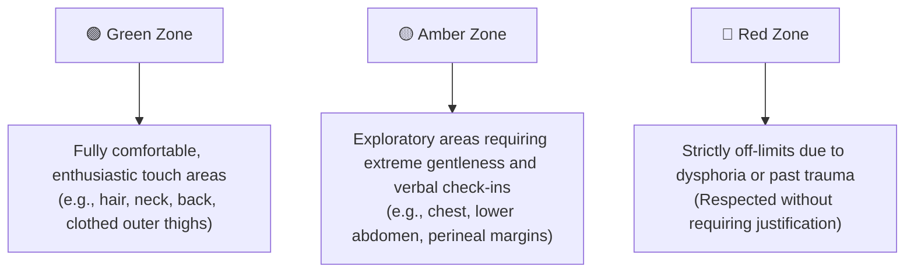

  <a href="README.md">简体中文</a> | <strong>English</strong>

  

# Warm Embrace: A Somatic Exploration & Outercourse Intimacy Guide for Transfeminine People
> ——Exploring Somatic Warmth, Gentle Self-Pleasure, and Intercrural Sex (Thigh Intimacy)

> [!NOTE] Translation Notice
> This English edition was generated with AI assistance and comprehensive review. As transfeminine somatic and community vernacular involves subtle cultural and emotional nuances, phrasing or context may occasionally vary from the original text. The **[Original Chinese Document (README.md)](./README.md)** remains the authoritative primary source. Terminology suggestions and translation improvements via Pull Requests or Issues are warmly welcome!

---

> **Document Classification**: Personal experience-driven community discussion & non-penetrative intimacy synthesis (*Community-sourced, Experience-based Informational Document*)  \
> **Background**: Curated by a transgender woman based on personal exploration, lived experiences, and a systematic synthesis of discussions across international trans community forums (primarily Reddit communities such as r/MtF and r/mypartneristrans), integrated with contemporary queer sex education literature (such as Allison Moon's *Girl Sex 101*) and clinical sexological guidelines.  \
> **Core Purpose & Diverse Audience Spectrum**: Rooted in the lived experiences and authentic somatic exploration of transfeminine people, welcoming individuals across all transition paths—whether you are **non-op (choosing not to undergo genital surgery)**, **pre-op (preparing for or awaiting surgery)**, or **post-op (having completed gender-affirming surgery)**; and whether or not you are on Gender-Affirming Hormone Therapy (GAHT/HRT). The right to intimacy, pleasure, and womanhood is self-sufficient and does not hinge on any specific medical procedure. Simultaneously, it offers a welcoming, tender reference space for anyone seeking to dismantle linear scripts and expand their intimate horizons.  \
> **Core Scope**: Grounded in broad **non-penetrative intimacy** (*Outercourse*), encompassing full-body touch, mindful sensory awareness, self-pleasure techniques, and toy resonance; while giving dedicated, deep anatomical, psychological, and harm-reduction focus to **intercrural intimacy** (*Intercrural Sex*, i.e., thigh sex) due to its high discussion prominence and uniquely enveloping comfort in community practice.
>
> **Important Disclaimers & Limitations**:
>
> 1. **Non-Medical & Non-Clinical Informational Resource**: This document is not a peer-reviewed clinical medical guideline and does not constitute medical, endocrine, or professional psychotherapy advice. For acute pain, persistent friction trauma, infections, severe gender dysphoria, or post-operative surgical concerns, please consult a qualified, trans-affirming healthcare practitioner or licensed therapist.
> 2. **Sampling Sources & Sourcing Bias**: Experiences cited are derived from keyword searches (*intercrural*, *thigh sex*, *outercourse*, *trans clit*, *grinding*, etc.) across public online forums. This methodology carries an inherent self-selection bias (capturing individuals actively exploring or positively responding to outercourse practices). It does not represent a statistical census of all transgender women.
> 3. **Absolute Respect for Individual Diversity**: Every transfeminine person's anatomy, hormonal trajectory, erogenous sensitivity, sexual orientation, and emotional boundaries are uniquely distinct. Any sexual or intimate practice is purely a parallel, voluntary option—**no one is required to engage in any specific sexual act to validate their gender identity or womanhood**.

---

## Table of Contents

1. [I. Expanding Somatic Horizons: Broad Practices of Outercourse & Body-to-Body Intimacy](#i-expanding-somatic-horizons-broad-practices-of-outercourse--body-to-body-intimacy)
2. [II. Physiological Foundations, Neural Homology & Sensory Reorganization](#ii-physiological-foundations-neural-homology--sensory-reorganization)
3. [III. Psychological Framing & Dysphoria Buffering: Spectatoring & Mindful Intimacy](#iii-psychological-framing--dysphoria-buffering-spectatoring--mindful-intimacy)
4. [IV. Community Lived Experiences: Diverse Hand Techniques, Masturbation & Intimate Practices](#iv-community-lived-experiences-diverse-hand-techniques-masturbation--intimate-practices)
5. [V. Diverse Partnership Dynamics, Bilateral Communication & Boundary Maps](#v-diverse-partnership-dynamics-bilateral-communication--boundary-maps)
6. [VI. Physiological Safety, Advanced Infection Prevention & Skin Care (Critical)](#vi-physiological-safety-advanced-infection-prevention--skin-care-critical)
7. [VII. Epilogue: Returning to Bodily Autonomy & Self-Compassion](#vii-epilogue-returning-to-bodily-autonomy--self-compassion)
8. [VIII. Academic References & Foundational Literature](#viii-academic-references--foundational-literature)

---

## I. Expanding Somatic Horizons: Broad Practices of Outercourse & Body-to-Body Intimacy

In mainstream reproductive-centric narratives, sex is frequently narrowed down to internal organ penetration (*Intercourse*). This conventional script often imposes multifaceted physical and psychological pressures on transfeminine individuals: non-op and pre-op individuals are often default-pressured into cis-male roles or confined to receptive anal penetration; while post-op individuals face physical limitations during dilation fatigue phases or mucosal recovery.

### 1. Broad "Outercourse" and Intercrural Sex

In contemporary sexology and queer education, **non-penetrative intimacy** (*Outercourse*) represents a broad, dignified, and self-sufficient domain encompassing all intimate expressions that do not involve inserting organs or hard toys into internal bodily cavities (vagina or rectum). It includes:

- Expansive skin-to-skin contact, embracing, deep kissing, and slow full-body caressing;
- Mindful tactile exploration, external vibration resonance, and mutual body grinding (*Tribadism / Frottage / Grinding*);
- **Intercrural Sex**: Derived from Latin *inter* [between] and *crura* [thighs], utilizing the natural angle and warm tactile friction of the inner thighs for rhythmical sliding and surface contact.

Within transfeminine communities, intercrural sex stands out because of its generous contact surface, warm envelopment, and visual shielding properties, providing an authentic haven for somatic grounding.

### 2. Sexological History & Cross-Cultural Context

Outercourse is by no means an inferior "substitute" or compromise; it has always occupied a central ecological niche across human sexual history:

- **The Kinsey Reports**: In *Sexual Behavior in the Human Male* (1948) and *Sexual Behavior in the Human Female* (1953), Alfred Kinsey's team systematically documented thigh contact and surface friction across diverse sexual orientations, establishing that non-penetrative intimacy has long been a stable, fulfilling, and safe human intimate practice.
- **Cross-Cultural Precedents**: From ancient Greek vase paintings depicting intercrural intimacy as a disciplined, affectionate expression, to Eastern traditional cultures emphasizing whole-body skin warmth (*"skin-to-skin intimacy"*), non-reproductive intimate touch has consistently showcased human erotic versatility.

### 3. Diverse Queer Practices

- **Sapphic Tribadism / Scissoring**: A foundational practice among women loving women, proving that surface friction sustains full physiological climax and emotional bonding without requiring phallic penetration.
- **Gay Male "Side" Identity**: A recognized sexual identity describing individuals who do not prefer receptive or insertive anal sex, focusing on body caresses, intercrural intimacy, kissing, and mutual manual play.
- **Transmasculine Exploration**: Trans men navigating testosterone-induced mucosal dryness or bottom dysphoria frequently utilize thigh pressure, external friction, or fabric barriers for release.
- **Queer Pedagogical Empowerment**: As Allison Moon and trans educator Tobi Hill-Meyer emphasize in *Girl Sex 101*: *"Trans women have sex in as wide a range of ways as everyone else does... If a couple just likes to feel each other up and grind without ever taking off their pants, more power to them."*

### 4. Core Stance: Non-Hierarchical Value & Bodily Autonomy

Internal penetration, surface friction, oral sex, and tender affection are completely equal in dignity and erotic worth. They can stand alone as complete intimate encounters or blend seamlessly. Intimacy has no mandatory linear script. Many transfeminine people find profound comfort in thigh friction; others find it physically unstimulating or positionally awkward. All bodily responses are completely valid.

---

## II. Physiological Foundations, Neural Homology & Sensory Reorganization

Whether or not a transfeminine person undergoes Gender-Affirming Hormone Therapy (GAHT), the body harbors rich sensory potential. Hormones reorganize physical responses, while mindful touch can awaken deep pelvic resonance regardless of medical intervention.

### 1. Embryological Homology & Pudendal Nerve Distribution

External genitalia originate from shared embryonic tissue and share identical innervation from the **Pudendal Nerve**:

- **Homological Mapping**:
  - Genital tubercle $\rightarrow$ Glans clitoris / Glans penis;
  - Urogenital folds $\rightarrow$ Labia minora / Ventral penile skin & corpus spongiosum;
  - Labioscrotal swellings $\rightarrow$ Labia majora / Scrotum;
  - Perineal raphe & scrotal seam share the exact embryonic closure line.
- **Tactile Nerve Retention**:
  Branches of the pudendal nerve (dorsal nerve, perineal nerve, and inferior rectal nerve) form a dense network across the perineal body and scrotal seam.
  - When GAHT reduces erectile volume and thins epidermal layers, the perineum (between the base of the genitalia and the anus) and scrotal raphe retain rich tactile corpuscles (Meissner's corpuscles and free nerve endings);
  - Moderate warmth, wide sliding friction, and blunt pressure directly activate these homologous neural pathways, triggering diffuse pelvic floor resonance without requiring an erection.

### 2. Muscle Control & Pelvic Floor Physical Therapy (PFPT) Insights

- **Adductor Muscle Agency**: The inner thigh adductor muscles are voluntary skeletal muscles. Unlike internal cavities regulated by involuntary autonomic reflexes, thigh firmness, rhythm, and pacing are completely in the individual's conscious control.
- **Managing Pelvic Floor Hypertonicity**:
  According to clinical guidelines from APTA Pelvic Health and POGP (UK), many transfeminine people experience **high-tone pelvic floor dysfunction** due to chronic bottom dysphoria, prolonged tucking, or post-surgical dilation stress.
  - *Down-Training & Breathing*: Incorporating **diaphragmatic breathing** (expanding the belly on inhalation to gently drop and stretch the pelvic floor) relieves protective pelvic muscle spasms, allowing pleasure to radiate freely.

### 3. Chest Development & Generalized Erogenous Mapping

- Under GAHT, breast development (budding, glandular expansion, and fat deposition) establishes a potent erogenous center away from genital triggers.
- In side-lying spooning, a partner’s free hands can caress the chest and neck while thighs glide in unison, creating multilayered full-body resonance.

---

> ### 💬 Scenario 1: Early GAHT Shifts in Libido & Bodily Alienation
>
> **[Common Dilemma]**: *"Six months on HRT with suppressed testosterone, my spontaneous erections vanished. Old masturbation techniques feel painful or completely unappealing. Am I permanently broken?"*  
> **[Community Wisdom]**: Testosterone reduction diminishes urgent localized impulses and thins epidermal skin, making aggressive stroking harsh. Shifting toward slow, full-body warmth (back cuddling, chest caressing, gentle thigh gliding) provides comforting envelopment while the nervous system adapts to its new endocrine rhythm. Climax is not a mandatory goal.

---

## III. Psychological Framing & Dysphoria Buffering: Spectatoring & Mindful Intimacy

### 1. Eliminating Preparation Fatigue (Prep Fatigue)

Receptive anal intimacy frequently involves demanding dietary restrictions, douching, and dilation, transforming intimacy into an exhausting clinical chore. Outercourse requires minimal preparation, fostering a spontaneous, low-stress environment.

### 2. Visual Safety & Genital Dysphoria Buffering

For pre-op and non-op transfemmes experiencing acute bottom dysphoria, direct genital exposure can trigger panic or dissociation:
- Spooning and side-lying postures naturally fold and shield the area from view;
- Soft underwear or gentle tucking establishes a physical and emotional comfort boundary.

### 3. Overcoming "Spectatoring" & Internalized Surveillance

In a society saturated with the male gaze and cisnormative beauty standards, individuals often experience an internal monitor judging their physical performance. Sexology terms this **Spectatoring** (first identified by Masters & Johnson)—mentally stepping outside one's body to judge oneself as a sexual object. For trans women, this easily intertwines with dysphoria and "passing" anxiety.

**Mindfulness-Based Sex Therapy (MBST) & Grounding Tools**:
- **Noticing & Labeling**: When thoughts arise (*"My hips aren't wide enough / I look awkward"*), label it gently: *"Ah, the inner critic is trying to protect me, but I am safe right now."*
- **Somatic Anchors**: Anchor awareness back into physical reality through the **temperature of the breath** or the **warmth of a partner's palm**.
- **The 5-4-3-2-1 Grounding Method**: If dissociation or acute panic occurs, pause intimacy immediately and ground together:
  - Identify 5 things you can see;
  - Touch 4 distinct textures (e.g., blanket, sheet, partner's knuckles);
  - Listen to 3 ambient sounds;
  - Notice 2 scents;
  - Taste 1 thing (e.g., a sip of warm water).

### 4. Bodily Self-Determination in Language (Julia Serano)

As trans theorist Julia Serano highlights in *Girl Sex 101*, **labels are descriptive, not prescriptive**. You hold absolute autonomy over how your anatomy is named—whether "clit," "girl-dick," "front bits," or neutral nicknames. Establishing affirming language prevents misgendering triggers during intimacy.

---

> ### 💬 Scenario 2: Trans-Straight Women & Partner Boundary Negotiation
>
> **[Common Dilemma]**: *"I love my cis boyfriend, but anal penetration causes me severe physical pain. Seeing his frustration makes me feel guilty and inadequate as a woman. Will thigh sex feel like an unfulfilling cop-out to him?"*  
> **[Community Wisdom]**: Partners in support groups often clarify that what they dread most is hurting the person they love. High-grade lubricant between warm, firm thighs provides generous snug friction and heat. Removing the fear of causing injury allows both partners to relax into genuine emotional intimacy. True intimacy is the intersection of mutual comfort, not unilateral sacrifice.

---

## IV. Community Lived Experiences: Diverse Hand Techniques, Masturbation & Intimate Practices

### 1. Side-Lying Spooning Position

- **Execution**: The receiver lies on their side facing away with legs softly bent; the partner cuddles from behind, sliding comfortably between the thighs.
- **Strengths**: Broad back contact calms sympathetic arousal, partners' hands remain free to caress the chest or face, and visual genital triggers are eliminated.

### 2. Fabric Barriers & Tucked Exploration (Sex While Tucked)

- Retaining seamless, soft modal or silk panties maintains compression and visual comfort.
- **Biomechanical Safety (Hernia Prevention)**:
  - **Never use high-tensile tape (tape tucking) during active friction intimacy**.
  - Prioritize relaxed, elastic underwear tucking. **Avoid pushing the testicles deeply into the inguinal canals when undergoing active body-to-body impact or compression**. Repeated high-pressure displacement can dilate the superficial inguinal ring, significantly increasing the risk of **inguinal hernias** and spermatic cord strain.

### 3. Reimagining Hand Techniques (Insights from *Girl Sex 101*)

- **The Softball Fold**: If the anatomy is soft or semi-erect, fold it gently upward or along the pubic crease. This creates a compact, cushioned mound, shifting touch away from vertical stroking toward circular, flat-palmed clitoral massage.
- **The Bike Seat (Perineal Blunt Pressure)**: Homologous erectile roots extend back into the perineum. Pressing the heel of the hand, a fist, or a knee firmly against the perineum (like a bicycle seat) triggers deep, diffuse pelvic resonance.
- **Safety Scissors**: Using the index and middle fingers as a soft scissor-hold around the base, sliding laterally with ample lubricant.

### 4. Wand Vibrators & Mutual Grinding

- **Pillow Pressing**: Lying prone over a soft pillow with an additional flat pillow under the pelvis/lower abdomen reduces lumbar strain and anchors the perineum firmly against the wide head of a Magic Wand.
- **Dual Wand Grinding (*Girl Sex 101*)**: Partners sit face-to-face in a lap-hug or side cuddle, placing a wide-head wand between their contacting thighs and bits, sharing gentle mechanical resonance.

### 5. Syntribation (Cushion & Plushie Grinding)

Rocking the pelvic floor against soft plushies or folded blankets allows hands-free release and deep blunt pressure over the perineal body.

### 6. Post-Operative Somatic Exploration & Dilation Fatigue

> [!WARNING]
> **Early Post-Op Healing Contraindications**: During the initial healing window (months following vaginoplasty), surgical flaps, suture lines, and neovaginal tissue are exceptionally fragile. **Any tight thigh squeezing, forceful adductor clamping, or perineal friction is strictly forbidden until full clinical clearance is granted by your surgical team**, due to acute risks of wound dehiscence and hematoma.

- After complete healing, outercourse remains a self-sufficient, dignified option.
- During long-term **Dilation Fatigue**, gentle thigh and vulvar touch offers a sanctuary to connect without placing mechanical strain on the neovagina.
- *Red Flags*: Any active bleeding, tearing, foul discharge, or severe pain during contact requires immediate specialist evaluation.

---

## V. Diverse Partnership Dynamics, Bilateral Communication & Boundary Maps

### 1. Trans-Straight Dynamics with Cis Male Partners
Dismantling the myth that "penetration equals masculinity." Male arousal is highly responsive to vocal cues, warmth, and muscular snugness. Reframing sex as a shared sensory playground eliminates performance anxiety for both partners.

### 2. Sapphic & T4T (Trans-for-Trans) Partnerships
Shared transgender experience does not guarantee identical dysphoria boundaries. Transparent communication remains crucial.

### 3. The "Traffic Light" Body Boundary Map

*Rule of Dynamic Boundaries*: Today’s green zone can become tomorrow’s red zone depending on fatigue and emotional state. No partner ever needs to apologize for shifting boundaries.

---

## VI. Physiological Safety, Advanced Infection Prevention & Skin Care (Critical)

### 1. STI Harm Reduction & Biomedical Prevention Updates

> [!WARNING]
> **Outercourse does not mean zero STI risk!** Skin-to-skin contact, fluid transfer, and micro-abrasions can transmit:
> - **HPV & HSV (Herpes)**: Transmitted through intimate epidermal/mucosal contact even during asymptomatic viral shedding.
> - **Syphilis**: Transmitted via direct contact with active lesions (chancres/mucous patches).
> - **Molluscum Contagiosum & Pubic Lice**: Readily spread through close skin contact and shared fabrics.

- **HPV Vaccination**: Complete 9-valent HPV vaccination is strongly recommended for all individuals regardless of gender, age, or surgical status.
- **Doxy-PEP (CDC 2024 Guidelines)**: For trans women and MSM, a single oral dose of **doxycycline 200mg taken within 72 hours** after condomless sexual exposure substantially lowers the risk of syphilis and chlamydia (by over 70%–80%).
- **Clarification on PrEP & GAHT Interactions**: Clinical trials confirm that standard oral PrEP (TDF/FTC or TAF/FTC) and gender-affirming hormone therapy do not compromise each other's clinical efficacy. They can be safely co-administered.
- **Anatomical Site-Specific Screening**: Request throat and rectal NAAT swabs alongside urine/blood tests based on actual exposure sites.

### 2. Epidermal Fragility & Friction Heat (Chafing)
Estrogen thins the stratum corneum and diminishes sebaceous lubrication. Friction burns (*chafing*) develop rapidly if lubrication dries out. Cease movement immediately upon feeling increased drag or stinging.

### 3. Lubricant Science: WHO Osmolality Standards & Microecology
- **WHO Osmolality Benchmark**: Personal lubricants should ideally have an **osmolality below 1,200 mOsm/kg** (physiological level is ~290–380 mOsm/kg). Hyperosmolar lubricants packed with glycerin or propylene glycol draw water out of epithelial cells, causing cellular dehydration and next-day burning pain.
- **Silicone Lubricants**: Exceptional, long-lasting slip for thigh friction. Compatible with natural latex and polyisoprene condoms; **strictly incompatible with silicone toys**. Never use mineral oil, petrolatum, or cooking oils with latex condoms.
- **Neovaginal pH Neutrality**: Neovaginal tissue (skin-graft or colon) lacks lactobacilli-dominated acidic flora; its physiological pH is typically **neutral to mildly acidic (pH 5.0–7.0)**. Avoid aggressive acidic feminine washes.

### 4. Aftercare & Clinical Red Flags
- Cleanse gently with warm water (and mild soap for silicone lube);
- Apply pure petrolatum or dexpanthenol (Vitamin B5) ointment to barrier-compromised skin;
- Practice emotional aftercare with hydration and reassurance against post-sex blues;
- *Seek medical care immediately* for blistering, yellow crusting, purulent discharge, burning micturition, or swollen inguinal lymph nodes.

---

## VII. Epilogue: Returning to Bodily Autonomy & Self-Compassion

Intimate exploration is not an exam to be graded, nor a performance to satisfy external spectators.

For non-op, pre-op, post-op, and non-hormonal transfeminine people alike, every mindful choice in bed is an act of reclaiming bodily autonomy. Intercrural and outercourse intimacy is not an exclusive panacea, but an open, warm doorway that has offered tender solace to thousands of community members.

May you always feel empowered to embrace your body and your loved ones on your own authentic terms.

---

## VIII. Academic References & Foundational Literature

1. **Moon, Allison**: *Girl Sex 101* (Illustrated by kd diamond; featuring Julia Serano & Tobi Hill-Meyer. Lunatic Ink, 2016).
2. **WPATH**: *Standards of Care for the Health of Transgender and Gender Diverse People, Version 8 (SOC-8)* (2022).
3. **ACOG**: *Committee Opinion No. 823: Health Care for Transgender and Gender Diverse Individuals* (2021).
4. **ESSM**: *Position Statement on Sexual Function and Satisfaction in Transgender Persons* (*J Sex Med*, 2020).
5. **Kinsey, A. C., et al.**: *Sexual Behavior in the Human Male* (1948) & *Sexual Behavior in the Human Female* (1953).
6. **WHO / UNFPA**: *Use and procurement of additional lubricants for male and female condoms and lubricants for personal use* (2012/2022).
7. **CDC**: *Clinical Guidelines for the Use of Doxycycline Post-Exposure Prophylaxis for Bacterial STI Prevention* (2024).
8. **APTA Pelvic Health / POGP**: *Physical Therapy Management for Transgender and Gender Diverse Individuals Across the Lifespan* (2023–2024).

---

## Community Feedback & Contributing

We welcome respectful contributions from the global queer community:
* **Experience Feedback**: Share insights via GitHub Issues.
* **Translation Improvements**: Pull Requests for nuanced phrasing and terminology refinements are warmly appreciated!

---

## License

This work is licensed under the [Creative Commons Attribution-NonCommercial-ShareAlike 4.0 International License (CC BY-NC-SA 4.0)](LICENSE).
