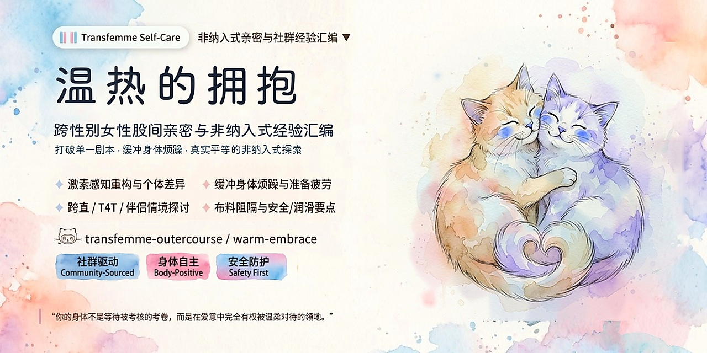

  <a href="README.md">简体中文</a> | <strong>English</strong>

  

  
  
  
  
  

# Warm Embrace: A Somatic Exploration & Outercourse Intimacy Guide for Transfeminine People
> ——Exploring Somatic Warmth, Gentle Self-Pleasure, and Intercrural Sex (Thigh Intimacy)

> [!NOTE] Translation Notice
> This English edition was generated with AI assistance and comprehensive review. As transfeminine somatic and community vernacular involves subtle cultural and emotional nuances, phrasing or context may occasionally vary from the original text. The **[Original Chinese Document (README.md)](./README.md)** remains the authoritative primary source. Terminology suggestions and translation improvements via Pull Requests or Issues are warmly welcome!

---

> **Document Classification**: Personal experience-driven community discussion & non-penetrative intimacy synthesis (*Community-sourced, Experience-based Informational Document*)
>
> **Background**: Curated by a transgender woman based on personal exploration, lived experiences, and a systematic synthesis of discussions across international trans community forums (primarily Reddit communities such as r/MtF and r/mypartneristrans), integrated with modern gender-inclusive sex education literature (such as Allison Moon's *Girl Sex 101*) and clinical sexological references.
>
> **Core Purpose & Diverse Audience Spectrum**: Rooted in the lived experiences and authentic somatic exploration of transfeminine people, welcoming individuals across all transition paths—whether you are **non-op (choosing not to undergo genital surgery)**, **pre-op (preparing for or awaiting surgery)**, or **post-op (having completed gender-affirming surgery)**; and whether or not you are on Gender-Affirming Hormone Therapy (GAHT/HRT). The right to intimacy, pleasure, and womanhood is self-sufficient and does not hinge on any specific medical procedure. Simultaneously, it offers a welcoming, tender reference space for anyone seeking to dismantle linear scripts and expand their intimate horizons.
>
> **Core Scope**: Grounded in broad **non-penetrative intimacy** (*Outercourse*), encompassing full-body touch, mindful sensory awareness, self-pleasure techniques, and toy resonance; while giving dedicated, deep anatomical, psychological, and harm-reduction focus to **intercrural intimacy** (*Intercrural Sex*, i.e., thigh sex) due to its high discussion prominence and uniquely enveloping comfort in community practice.
>
> **Important Disclaimers & Limitations**:
>
> 1. **Non-Medical & Non-Clinical Informational Resource**: This document is not a peer-reviewed clinical medical guideline and does not constitute medical, endocrine, or professional psychotherapy advice. For acute pain, persistent friction trauma, infections, severe gender dysphoria, or post-operative surgical concerns, please consult a qualified, trans-affirming healthcare practitioner or licensed therapist.
> 2. **Sampling Sources & Sourcing Bias**: Experiences cited are derived from keyword searches (*intercrural*, *thigh sex*, *outercourse*, *trans clit*, *grinding*, etc.) across public online forums. This methodology carries an inherent self-selection bias (capturing individuals actively exploring or positively responding to outercourse practices). It does not represent a statistical census of all transgender women.
> 3. **Absolute Respect for Individual Diversity**: Every transfeminine person's anatomy, hormonal trajectory, erogenous sensitivity, sexual orientation, and emotional boundaries are uniquely distinct. Any sexual or intimate practice is purely a parallel, voluntary option—**no one is required to engage in any specific sexual act to validate their gender identity or womanhood**.

---

## Table of Contents

1. [I. Expanding Somatic Horizons: Broad Practices of Outercourse](#i-expanding-somatic-horizons-broad-practices-of-outercourse)
2. [II. How the Body Experiences Pleasure: Somatic Basis, Neural Homology & Sensory Rewiring](#ii-how-the-body-experiences-pleasure-somatic-basis-neural-homology--sensory-rewiring)
3. [III. Psychological Adjustment & De-escalation: Buffering Dysphoria & Reducing Self-Spectating](#iii-psychological-adjustment--de-escalation-buffering-dysphoria--reducing-self-spectating)
4. [IV. Community Lived Experiences: Exploring Somatic Pleasure, Gentle Masturbation & Intimate Practices](#iv-community-lived-experiences-exploring-somatic-pleasure-gentle-masturbation--intimate-practices)
5. [V. Diverse Partnership Dynamics, Bilateral Communication & Boundary Maps](#v-diverse-partnership-dynamics-bilateral-communication--boundary-maps)
6. [VI. Physiological Safety, Advanced Infection Prevention & Skin Care (Critical)](#vi-physiological-safety-advanced-infection-prevention--skin-care-critical)
7. [VII. Epilogue: Returning to Bodily Autonomy & Self-Compassion](#vii-epilogue-returning-to-bodily-autonomy--self-compassion)
8. [VIII. Academic References & Foundational Literature](#viii-academic-references--foundational-literature)

---

## I. Expanding Somatic Horizons: Broad Practices of Outercourse

In mainstream reproductive-centric narratives, sex is frequently narrowed down to internal organ penetration (*Intercourse*). This conventional script often imposes multifaceted physical and psychological pressures on transfeminine individuals: non-op and pre-op individuals are often default-pressured into cis-male roles or confined to receptive anal penetration; while post-op individuals face physical limitations during dilation fatigue phases or mucosal recovery.

### 1. Broad "Outercourse" and Intercrural Sex

In modern sex education and sexual health frameworks, **non-penetrative intimacy** (*Outercourse*) represents a broad, dignified, and self-sufficient domain encompassing all intimate expressions that do not involve inserting organs or hard toys into internal bodily cavities (vagina or rectum). It includes:

- Expansive skin-to-skin contact, embracing, deep kissing, and slow full-body caressing;
- Tactile exploration, external vibration resonance, and mutual body grinding (*Tribadism / Frottage / Grinding*);
- **Intercrural Sex**: Derived from Latin *inter* [between] and *crura* [thighs], utilizing the natural angle and warm tactile friction of the inner thighs for rhythmical sliding and surface contact. Employed here as a desexualized, clinical sexology term, it intentionally moves away from vulgarized labels toward an objective understanding of tactile contact and somatic biomechanics.

Within transfeminine communities, intercrural sex stands out because of its generous contact surface, warm envelopment, and visual shielding properties, providing an authentic haven for somatic grounding.

### 2. Sexological History & Cross-Cultural Context

Outercourse is by no means an inferior "substitute" or compromise; it has always occupied a central ecological niche across human sexual history:

- **The Kinsey Reports**: In *Sexual Behavior in the Human Male* (1948) and *Sexual Behavior in the Human Female* (1953), Alfred Kinsey's extensive interviews repeatedly documented thigh contact and surface friction across diverse sexual orientations, establishing that non-penetrative touch has long been an organic, fulfilling part of the human erotic spectrum rather than a compromise.
- **Cross-Cultural Precedents**: From ancient Greek vase depictions featuring mutual intercrural touch, to Eastern traditional philosophies emphasizing whole-body warmth (*"skin-to-skin intimacy"*), non-reproductive intimate touch has consistently showcased human erotic versatility.

### 3. Diverse Community Practices

- **Sapphic Tribadism / Scissoring**: A foundational practice among women loving women, proving that surface friction sustains full physiological climax and emotional bonding without requiring phallic penetration.
- **Gay Male "Side" Identity**: A recognized sexual identity describing individuals who do not prefer receptive or insertive anal sex, focusing on body caresses, intercrural intimacy, kissing, and mutual manual play.
- **Transmasculine Exploration**: Trans men navigating testosterone-induced mucosal dryness or bottom dysphoria frequently utilize thigh pressure, external friction, or fabric barriers for release.
- **Gender-Inclusive Pedagogical Empowerment**: As trans scholar Tobi Hill-Meyer writes in *Girl Sex 101*: *"Trans women have sex in as wide a range of ways as everyone else does... If a couple just likes to feel each other up and grind without ever taking off their pants, more power to them."*

### 4. Core Stance: Non-Hierarchical Value & Bodily Autonomy

- **Grounded in Transfeminine Experience, Offering Exploratory Pathways**: The experiences compiled here are rooted in transfeminine somatic exploration. They do not seek to establish a new mandatory standard, nor do they imply that outercourse is an automatic panacea for everyone. In community reality, **many find profound comfort and warmth in thigh intimacy; others feel neutral, or experience discomfort from friction, warmth, or posture—all of these reactions are completely authentic and normal**. If you try it and feel it is not for you, you can freely set it aside and explore other avenues.
- **De-Hierarchical Value**: Internal penetration, surface friction, intercrural intimacy, oral sex, and tender affection are completely equal in dignity and erotic worth. **They can stand alone as complete intimate encounters or blend seamlessly; intimacy has no mandatory linear script, and the core always rests on mutual consent and boundary attunement.**

---

## II. How the Body Experiences Pleasure: Somatic Basis, Neural Homology & Sensory Rewiring

Whether or not a transfeminine person undergoes Gender-Affirming Hormone Therapy (GAHT), the body harbors rich sensory potential. Hormones reorganize physical responses, while mindful touch can awaken deep pelvic resonance regardless of medical intervention.

### 1. Embryological Homology & Pudendal Nerve Distribution

External genitalia originate from shared embryonic tissue and share identical innervation from the **Pudendal Nerve**:

- **Homological Mapping**:
  - Genital tubercle → Glans clitoris / Glans penis;
  - Urogenital folds → Labia minora / Ventral penile skin & corpus spongiosum;
  - Labioscrotal swellings → Labia majora / Scrotum;
  - Perineal raphe & scrotal seam share the exact embryonic closure line.
- **Tactile Nerve Retention**:
  Branches of the pudendal nerve (dorsal nerve, perineal nerve, and inferior rectal nerve) form a dense network across the perineal body and scrotal seam.
  - When GAHT reduces erectile volume and thins epidermal layers, the perineum (between the base of the genitalia and the anus) and scrotal raphe retain rich tactile corpuscles;
  - Moderate warmth, wide sliding friction, and blunt pressure directly activate these homologous neural pathways, triggering diffuse pelvic floor resonance without requiring an erection.

### 2. Muscle Control & Pelvic Floor Relaxation

- **Subcutaneous Fat Redistribution**: Feminizing hormone therapy encourages adipose tissue redistribution toward the hips, buttocks, and thighs, making the inner thighs softer and providing natural cushioning for surface friction; (*Note: Fat redistribution is heavily influenced by genetics, baseline BMI, and duration of GAHT, and will not manifest uniformly across all bodies*);
- **Adductor Muscle Agency**: The inner thigh adductor muscles are voluntary skeletal muscles. Unlike internal cavities regulated by involuntary autonomic reflexes, thigh firmness, rhythm, and pacing are completely in the individual's conscious control.
- **Pelvic Floor Tone Regulation**:
  In clinical physical therapy, many transfeminine people experience elevated pelvic floor muscle tone due to chronic bottom dysphoria, prolonged tucking, or post-surgical dilation stress.
  - Incorporating **diaphragmatic breathing** (expanding the belly on inhalation to gently drop and stretch the pelvic floor) relieves protective pelvic muscle spasms, allowing pleasure to radiate freely.

### 3. Chest Development & Generalized Erogenous Mapping

- Under GAHT, breast development (budding, glandular expansion, and fat deposition) establishes a potent erogenous center away from genital triggers.
- In side-lying spooning, a partner’s free hands can caress the chest and neck while thighs glide in unison, creating multilayered full-body resonance.

### 4. Generalization of Erogenous Mapping: From Localized Stimulation to Full-Body Resonance

In community discussions, many describe intimate experiences under feminine endocrinology (or through mindful relaxation) as having greater "full-body diffusion":
- Shifting from localized organ tension to shared awakening across the neck, collarbones, chest, lower back, and inner thighs;
- Intertwining warmth, breathing, and gentle touch into enduring emotional and somatic resonance.

**The Coexistence and Autonomous Choice of Pleasure Modes**:

As many transfeminine individuals recognize through personal exploration: **The focused impulse of localized stimulation and the gentle roaming of diffuse sensation are natural, coexisting potentials within the human body; they are not bound to a single gender or anatomy. Somatic pleasure is shaped by physiological, psychological, and relational contexts, rather than hormones alone.** Endocrine changes do not invent a rigid, singular model.

Additionally, some individuals are naturally on the **asexual (ace) or low-libido spectrum**, or experience extended phases where they naturally prefer quiet emotional cuddling and skin warmth over sexual release. Low or absent physical urgency is wholly valid and healthy; you never need to "restore" a high-frequency sex drive to prove your wholeness or validity.

Whatever your physical circumstances or gender journey, you possess the full agency to explore, combine, and cultivate the modes that resonate most authentically with your comfort and pacing.

---

> ### 💬 Scenario 1: Early GAHT Shifts in Libido & Bodily Alienation
>
> **【Typical Dilemma & Context】**
>
> *“Six months on HRT with suppressed testosterone, my spontaneous erections vanished. Old masturbation techniques feel painful or completely unappealing. Am I permanently broken?”*
>
> **【Community Discussion & Synthesis】**
>
> Testosterone reduction diminishes urgent localized impulses and thins epidermal skin, making aggressive stroking harsh. Shifting toward slow, full-body warmth (back cuddling, chest caressing, gentle thigh gliding) provides comforting envelopment while the nervous system adapts to its new endocrine rhythm.
>
> **【Facilitator Advice & Safety Memo】**
>
> Release the pressure to achieve an urgent climax. Allow the body time to reconnect under its new rhythm. If accompanied by persistent severe depression or physical lethargy, consult an affirming endocrinologist or therapist.

---

## III. Psychological Adjustment & De-escalation: Buffering Dysphoria & Reducing Self-Spectating

### 1. Eliminating Preparation Fatigue (Prep Fatigue)

Receptive anal intimacy frequently involves demanding dietary restrictions, douching, and dilation, transforming intimacy into an exhausting clinical chore. Outercourse requires minimal preparation, fostering a spontaneous, low-stress environment.

### 2. Visual Safety & Genital Dysphoria Buffering

For pre-op and non-op transfemmes experiencing acute bottom dysphoria, direct genital exposure can trigger panic or dissociation:
- Spooning and side-lying postures naturally fold and shield the area from view;
- Soft underwear or gentle tucking establishes a physical and emotional comfort boundary.

### 3. Easing Self-Surveillance & Performance Burden (Societal Aesthetics & Spectatoring)

Under the subtle influence of external evaluations, societal aesthetic standards, and adult media, many people carry an internal critic watching over their private moments—nitpicking bone contours, physical lines, or anatomical features, and grading whether their voice, posture, or expressions fit the mold of a "competent sexual object."

In psychology and sexology, this is recognized as **Self-Objectification** and **Spectatoring** (mentally detaching to judge one's own sexual performance). For transfeminine people, this internalized surveillance often intertwines with gender dysphoria and "passing" anxiety, creating a heavy burden of performative pleasing.

Remember: Regardless of past wounds or external judgments, **within your own bed, your body does not need to submit an exam to anyone**. Your body is a breathing, feeling sanctuary deserving of tender care.

**Allowing Sensations to Flow Freely**:
- **Embracing Clumsiness**: It is entirely okay to be quiet, clumsy, paused, or resting your head in a pillow. Let go of people-pleasing and embrace the unpolished present;
- **Dimming Visual Critique**: Dim the lights or close your eyes. Closing your eyes is not avoidance; it is cutting off visual self-surveillance to bring attention back to skin contact and warmth;
- **Feeling Reciprocal Love**: Release the obsession with perfection. Open your eyes to see your partner’s tender regard. Intimacy is laying down defense in mutual warmth;
- **Affirming Anatomical Language**: Within the private intimate space shared with a partner, many individuals collaboratively choose affirming terms for their bodies (such as "clit," "girl-dick," or neutral terms, as advocated by scholars like Julia Serano in relationship dynamics). Treating anatomy labels as *descriptive rather than prescriptive* strictly within partner intimacy avoids public controversy while eliminating misgendering discomfort in private.

> 💡 **Somatic Safety Memo**: Self-surveillance, dysphoria, and trauma-induced dissociation have distinct mechanisms. If acute dissociation or panic occurs, **closing one's eyes or pushing through is insufficient**. Pause intimacy immediately and use somatic grounding techniques (feet planted on the floor, wrapped in a weighted blanket, holding a warm mug of water, or utilizing the **5-4-3-2-1 sensory grounding technique**: noticing 5 visible objects, 4 touchable textures, 3 ambient sounds, 2 scents, and taking 1 sip of warm water). Seek professional psychological support if needed.

---

> ### 💬 Scenario 2: Trans-Straight Women & Partner Boundary Negotiation
>
> **【Typical Dilemma & Context】**
>
> *“I love my cis boyfriend, but anal penetration causes me severe physical pain. Seeing his frustration makes me feel guilty and inadequate as a woman. Will thigh sex feel like an unfulfilling cop-out to him?”*
>
> **【Community Discussion & Synthesis】**
>
> Partners in support groups often clarify that what they dread most is hurting the person they love. High-grade lubricant between warm, firm thighs provides generous snug friction and heat. Removing the fear of causing injury allows both partners to relax into genuine emotional intimacy.
>
> **【Facilitator Advice & Safety Memo】**
>
> Enduring pain to please a partner risks retraumatization. Communicate honestly: *"I deeply want to be close with you, but my body needs an intimate language that feels safe and painless."* True intimacy is the intersection of mutual comfort, not unilateral sacrifice.

---

## IV. Community Lived Experiences: Exploring Somatic Pleasure, Gentle Masturbation & Intimate Practices

Self-pleasure and somatic exploration are wholly legitimate and self-affirming—never a fault requiring shame, nor a source of post-orgasmic guilt or self-deprecation. When exploring, feel invited to curate an unhurried, safe sanctuary for yourself (such as curling into a warm blanket or dimming the lights), releasing mechanical urgency and treating your body with the gentleness you deserve.

The following practices and techniques are synthesized from community discussions and modern sex education literature, offering pathways for solo exploration or partnered intimacy:

### 1. Side-Lying Spooning Position

- **Execution**: The receiver lies on their side facing away with legs softly bent; the partner cuddles from behind, sliding comfortably between the thighs;
- **Strengths**: Broad back contact calms sympathetic arousal, partners' hands remain free to caress the chest or face, and visual genital triggers are eliminated.

### 2. Fabric Barriers & Somatic Exploration while Tucked (Sex while Tucked)

> 💡 **Concept & Core Safety Boundary**:
> "Tucking" refers to the somatic practice of gently positioning the external genitalia backward and flat against the perineum, held securely with form-fitting clothing to maintain a smooth bodily contour. During intimate exploration or surface grinding, **safety boundaries are paramount**: **Never use high-tensile medical tape (tape tucking) during active friction intimacy**, and **avoid forcefully displacing the testicles deeply into the inguinal canals under direct body weight or impact compression**. Rely exclusively on flexible, seamless, soft modal or silk underwear for gentle, relaxed wrapping. If you experience pulling, sharp tension, or dull aching in the lower abdomen or groin, pause immediately and release.

- **Experiential Advantages & Affirmation**:
  - **Sensory & Visual De-escalation**: Retaining soft, seamless underwear builds a tender physical shield, diminishing dysphoria triggered by direct exposure;
  - **Somatic Gender Affirmation**: The smooth, secure contour diminishes anatomical dissonance, providing deep emotional grounding and comfort;
  - **Fabric as a Lubrication Matrix**: Thin fabric infused with lubricant provides a smooth, frictionless sliding interface that protects against chafing and friction burns;
- **Protection Reminder**: While underwear fabric significantly buffers mechanical chafing, **it does not substitute for barrier contraception or STI protection** (fluids easily permeate normal fabrics; see Chapter VI).

### 3. Wand Vibrators & Mutual Grinding

In community discussions (e.g., Reddit r/MtF), broad-spectrum wand vibrators (such as the Magic Wand) are celebrated as gentle, affirming tools for somatic reconnection:

- **Pillow Pressing**: Lying prone over a soft pillow with an additional flat pillow under the pelvis/lower abdomen reduces lumbar strain and anchors the perineum firmly against the wide head of a Magic Wand, eliminating visual triggers while generating deep, diffuse warmth;
- **Perineal Band & Deep Pelvic Conduction**: Gently applying the broad vibrating head against the smooth perineal band between the genital base and the anus while practicing slow diaphragmatic breathing. The dense branching of the pudendal nerve conducts vibrations deep into the pelvic floor without requiring direct contact with sensitive anterior anatomy;
- **Dual Wand Grinding**: Partners sit face-to-face in a lap-hug or side cuddle, placing a wide-head wand between their contacting thighs and bits, sharing gentle mechanical resonance.

### 4. Syntribation (Cushion & Plushie Grinding)

Rocking the pelvic floor against soft plushies or folded blankets allows hands-free release and deep blunt pressure over the perineal body. Many individuals report that this rhythmic vascular engagement and muscular release brings a soothing, diffuse sense of full-body security.

- *Exploration Tips*:
  - Prioritize soft, fluffy pillows or plushies to cushion against hard surface pressure;
  - Synchronize movements with steady diaphragmatic breathing, shifting posture as needed to prevent lumbar or hip muscular fatigue.

### 5. Gentle Touch & Hand Perception: De-Mechanizing Somatic Exploration

Under hormonal changes or deep relaxation, spontaneous rigidity shifts. Modern sex education literature (such as *Girl Sex 101*) and community discussions highlight non-mechanical hand touch that honors feminized sensory pathways:

*(Note: The following names originate from vivid English-speaking community analogies. Their core message is to prioritize gentle, wide-surface warmth over rigid erection; feel free to adapt them to your own bodily comfort.)*

- **The Softball Fold**: When anatomy is soft or semi-erect, fold it gently upward or along the pubic crease. This breaks the phallic grip reflex and redirects focus to flat-palmed, circular massage akin to expansive clitoral stimulation;
- **The Bike Seat (Perineal Blunt Pressure)**: Homologous erectile roots extend deep into the perineum. Pressing the heel of the hand, a fist, or a knee firmly against the perineal body (like a bicycle saddle) awakens deep pelvic resonance;
- **Lateral Sliding Touch**: Using the index and middle fingers in a gentle scissor-hold around the base, sliding laterally with ample lubricant as a soft alternative to vertical stroking.

---

> ### 💬 Scenario 3: Partner Guidance, Operational Nuances & Chafing Prevention
>
> **【Typical Dilemma & Question】**
>
> *"My girlfriend shared that she is uncomfortable with direct touch down there and would like to try intimacy with me between her thighs. I'm completely on board, but I've never tried this before. Are there any common pitfalls or things I should be careful of? I'm terrified of being too rough and hurting her."*
>
> **【Community Insights & Best Practices】**
>
> 1. **Top Pitfall: Lubricant Evaporation & Friction Burns (Chafing)**: Partners often assume outer touch carries zero skin risk. However, the large surface area and friction warmth of the thighs can rapidly evaporate water-based lubricants. Continuing to slide when dry shears the stratum corneum, causing fiery friction burns the next morning. Prioritize premium long-lasting silicone lubricant (if not using silicone toys) or wear ultra-thin modal boxer briefs as a protective fabric barrier; pause to reapply lubricant immediately if resistance increases;
> 2. **Slow Down & Focus on Gentle Grinding**: Emphasize slow, sensual skin-to-skin resonance and breathing synchronization rather than rapid, forceful thrusting. Wrap your arms tenderly around her upper body to foster full-body intimacy;
> 3. **Lead by the Transfeminine Partner**: The transfeminine partner should regulate tightness and rhythm via her adductor muscles, with the partner gently adapting to her pace and verbally checking in.
>
> **【Aftercare & Emergency Notes】**
>
> If next-day redness or chafing occurs, avoid hot water and harsh soaps. Gently pat dry and apply pure petrolatum or dexpanthenol (Vitamin B5) cream, and wear loose cotton shorts. If blistering, crusting, or purulent signs appear, seek clinical evaluation promptly.

---

### 6. Post-Operative Somatic Exploration & Dilation Fatigue

> [!WARNING]
> **Early Post-Op Healing Contraindications**:
>
> During the initial post-operative recovery window (timeline varies significantly by surgical method—penile inversion, peritoneal, or colon vaginoplasty—and must strictly adhere to your surgeon's discharge protocol), surgical flaps, suture lines, and neovaginal tissue are exceptionally fragile. **Forceful adductor clamping, tight thigh squeezing, or vigorous friction near the surgical site carries severe clinical risks of wound dehiscence or hematoma!**
>
> Intimacy during early convalescence should be limited to verbal connection, hand holding, gentle cuddling, and upper-body caressing. Avoid all strenuous thigh compression or perineal friction until full clinical clearance.

- **Multidimensional Somatic & Solo Exploration**:
  - *Internal & External Play*: After complete healing, internal penetration, gentle clitoral/vulvar circular caresses, and finger or toy canal self-pleasure with ample lubrication are fulfilling exploratory modes;
  - *Outercourse as an Autonomous Sanctuary*: Bodily pleasure does not depend on anatomical changes alone. Thigh intimacy and mutual body warmth remain completely dignified options at all stages;
- During long-term **Dilation Fatigue**, gentle thigh and vulvar touch offers a sanctuary to connect without placing mechanical strain on the neovagina;
- *Red Flags*: Any active bleeding, tearing, foul discharge, or severe pain during contact requires immediate specialist evaluation.

---

> ### 💬 Scenario 4: Post-Op Dilation Fatigue & Emotional Vulnerability
>
> Normalizing dilation fatigue as a natural psychological response to repetitive physical discomfort, reassuring that taking a gentle pause with outercourse is a loving, valid sanctuary.

---

## V. Diverse Partnership Dynamics, Bilateral Communication & Boundary Maps

### 1. Trans-Straight Dynamics with Cis Male Partners

- **Dismantling Performance Myths**: Male arousal is highly responsive to vocal cues, skin warmth, and muscular snugness. Guiding a partner to reframe intimacy as a shared sensory playground rather than an exam of conquest transforms the dynamic;
- **Mutual De-escalation & Embracing Partner Vulnerability**: Eliminating the anxiety of "causing pain or tissue trauma" liberates both partners into a deeper emotional connection. Concurrently, male partners frequently navigate daily fatigue, situational erectile difficulties, or performance anxiety. Outercourse strips away the rigid demand to "stay hard and penetrate," opening up an unhurried, loving space for mutual rest and genuine somatic comfort;
- **De-singularizing Partner Expectations**: Male partners vary in individual preferences, sensitivities, and communication styles. Never assume every partner will immediately adapt or achieve identical orgasmic feedback through outercourse without patient, egalitarian exploration.

### 2. Trans-Sapphic & T4T (Trans-for-Trans) Partnerships

- **Decentering Phallocentrism**: In sapphic and queer partner dynamics, outercourse and intercrural intimacy are natural extensions of tribadism and whole-body touch, dismantling linear scripts fixated on penetration or ejaculation;
- **Realities of T4T Relationships**: Shared transgender background does not guarantee identical dysphoria boundaries or HRT milestones. Active boundary communication remains essential—never assume a partner automatically knows where your comfort line lies;
- **Body Diversity & Ergonomic Support**: Partners naturally vary in flexibility, body size, and stamina. Intimacy never requires uncomfortable contortions. Placing one or two soft pillows or folded blankets beneath the hips, lower back, or knees significantly reduces joint and lumbar strain, allowing both partners to relax into effortless, prolonged warmth.

### 3. Practical Tool: The "Traffic Light" Body Boundary List

Establishing a shared, neutral shorthand prior to intimacy significantly lowers anxiety. **This is not a cold legal contract, disclaimer, or rigid protocol, but a tender, open-hearted conversation.** Discussing each other's bodily boundaries in a relaxed atmosphere is in itself a deeply bonding experience—it reassures both partners on how to keep each other safe, completely dissolving performance anxiety and the fear of "making a wrong move."

Partners can outline their current somatic boundaries beforehand:

- 🟢 **Green Light**: Zones that feel completely safe, relaxing, and eagerly open to touch (e.g., hair, neck, back, clothed outer thighs);
- 🟡 **Amber Light**: Exploratory zones requiring extreme gentleness, verbal check-ins, and ready to pause at any moment (e.g., chest, lower abdomen, perineal edges);
- 🔴 **Red Light**: Absolute off-limits areas due to intense dysphoria or past trauma (respected without requiring justification).

**Mindset & Dynamic Principles**:
- **Rule of Dynamic Boundaries**: Green zones can shift to red zones depending on daily fatigue, hormonal fluctuations, and emotional state. Neither partner ever needs to apologize for shifting boundaries;
- **Sober Consent**: Intimate exploration should take place with sober, mutual awareness. If alcohol or substances are present, agree on boundaries beforehand and ensure either partner can call a comfortable pause at any moment.

### 4. Vigilance Against Fetishizing Objectification (Chasers) & Asserting Bodily Sovereignty

Genuine intimacy is founded on mutual love and respect, never on unilateral entitlement or objectifying consumption. In dating and social platforms, transfeminine people frequently encounter individuals who hyper-sexualize or reduce trans bodies to pornographic tropes (commonly referred to as "Chasers"):

- **Differentiating Sincere Connection from Fetishization**: An affirming partner cares about your emotional well-being, honors your life pacing, and sees you as a whole, authentic woman. In contrast, those with fetishizing motives often obsess over anatomical parts, push boundaries impatiently, and treat intimacy as a checklist to fulfill their private fantasies;
- **Asserting the Absolute Right to Refuse**: Intimacy is never a toll you must pay to prove your desirability or preserve a relationship. The moment you feel objectified, uncomfortable, or violated, you possess the full, unconditional sovereignty to disengage, say no, or block without apology;
- **Patience for Clumsiness, Zero Tolerance for Violation**: We can be wonderfully patient with a partner’s genuine awkwardness during mutual exploration; however, patience is predicated on mutual listening. Enforcing boundaries is never a disruption of intimacy—it is the bedrock of self-respect that shields you from harm;
- **Intra-Community Inclusivity & Boundary Awareness**: Boundary pressure can occasionally arise within trans spaces (e.g., seasoned peers overstepping boundaries under the guise of "shared experience"). Furthermore, many trans women navigate intense personal dysphoria and body anxiety. This pain is entirely human and deserves compassionate listening. What we must gently guard against is channeling personal insecurity into policing or competing with peers (such as comparing who is "more feminine" or "more passing"). True bodily sovereignty flourishes when we honor each other's differences and journey at our own pace, without ever needing to diminish sisters to validate ourselves.

---

> ### 💬 Scenario 5: Navigating Bidirectional Body Dysphoria in T4T Relationships
>
> **【Typical Dilemma & Context】**
>
> *"My partner and I are both transfemme. We love each other deeply, but whenever clothes come off, acute bottom dysphoria can suddenly trigger severe distress for one or both of us... How can we explore intimacy safely while honoring mutual vulnerabilities?"*
>
> **【Community Discussion & Synthesis】**
>
> Distilled from couples where both partners are pre-op/non-op: undressing is not a mandatory prerequisite for intimacy. "Low-exposure, high-barrier" cuddles offer profound peace of mind:
>
> 1. **Clothed & Tucked Intimacy**: Retaining soft silk shorts or a light tuck ensures physical closeness without visual panic;
> 2. **Bedsheet Grinding & Shared Resonance**: Spooning under a blanket or sandwiching a broad wand vibrator between hips conveys gentle warmth;
> 3. **Sensory Re-anchoring**: Focusing on hair, collarbones, breathing, and emotional reassurance.
>
> **【Facilitator Advice & Safety Memo】**
>
> Shared identity does not imply identical dysphoria thresholds. Check in beforehand: *"Which areas feel safe today, and which are completely off-limits?"* Mutual emotional safety always precedes erotic expression.

---

## VI. Physiological Safety, Advanced Infection Prevention & Skin Care (Critical)

Informed consent and physical health remain the foundational bedrock of all intimate exploration.

### 1. STI Harm Reduction & Scientific Prevention Advice

> [!WARNING]
> **Outercourse does not mean zero STI risk!**
>
> Skin-to-skin contact, fluid transfer, and micro-abrasions can transmit:
> - **HPV & HSV (Herpes)**: Transmitted through intimate epidermal/mucosal contact even during asymptomatic viral shedding;
> - **Syphilis**: Transmitted via direct contact with active lesions (chancres/mucous patches);
> - **HIV & Bloodborne Pathogens**: Negligible risk on intact skin, but requires caution if epidermal abrasions or fluid-to-mucosa contact occurs;
> - **Molluscum Contagiosum & Pubic Lice**: Readily spread through close skin contact and shared fabrics.

#### Scientific Harm Reduction & Health Guidelines

> ⚠️ **Important Notice**: This document provides educational information and synthesizes international public health updates; it does not constitute clinical medical prescriptions or treatment protocols. Readers are strongly advised to consult official guidelines directly or seek individualized guidance from qualified, trans-affirming clinicians.

- **Informed Communication & Deferring Contact with Lesions**: Practice transparent communication regarding STI testing histories; if rashes, blisters, open abrasions, or ulcers are present on the groin or contact zones, defer direct skin contact until fully resolved or medically evaluated;
- **Understanding Fabric Barrier Limits**: Soft underwear minimizes skin-to-skin friction, **but everyday fabrics do not block fluid transmission or cover all affected zones, and must never be treated as an equivalent substitute for condoms**;
- **HPV Vaccination Benefits**: Because close epidermal contact can transmit HPV, public health agencies (WHO, CDC) widely recommend the 9-valent HPV vaccine, offering substantial protective benefits regardless of gender or surgical status;
- **HIV Prophylaxis (PrEP/PEP) & GAHT Compatibility**: Clinical trials confirm no significant adverse pharmacological interference between standard PrEP/PEP regimens and gender-affirming hormone therapy (GAHT). Vital preventative care should never be delayed due to hormone concerns;
- **Frontier Discussion: Bacterial Post-Exposure Prophylaxis (Doxy-PEP)**: While international guidelines reference post-exposure doxycycline for reducing bacterial STI risks (syphilis, chlamydia), antibiotic resistance concerns and individual indications necessitate professional medical evaluation. Avoid unprescribed online purchasing, and consult an infectious disease specialist;
- **Conception & Pregnancy Considerations**: If an intimate partner has the physiological capacity to produce ova or carry a pregnancy, active secretions coming into contact with the vulva theoretically carry a non-zero risk of conception. If pregnancy is not desired, barrier precautions remain recommended;
- **Site-Specific Screening**: During routine sexual health check-ups, communicate actual intimate contact sites with affirming clinicians so that appropriate swab tests can be performed alongside standard urine and blood tests.

### 2. GAHT-Induced Skin Fragility & Friction Heat (Chafing)

Estrogen thins the stratum corneum and diminishes sebaceous lubrication, making the skin softer yet more vulnerable to friction. If continuous sliding occurs without adequate lubrication, mechanical damage ensues:

- **Friction Burns (Chafing)**: Presents initially as redness and burning; unaddressed, it can progress to skin peeling, serous weeping, and folliculitis;
- **Pacing & Stopping Early**: The moment sliding resistance increases or a stinging sensation arises, pause immediately to reapply lubricant.

### 3. Lubricant Science: WHO Osmolality Standards & Material Compatibility

- **WHO Osmolality Benchmark**:
  WHO quality standards recommend personal lubricants maintain an **osmolality below 1,200 mOsm/kg** (physiological benchmark ~290–380 mOsm/kg).
  - *Risks of Hyperosmolality*: Inexpensive water-based lubricants often rely on dense glycerin or propylene glycol, with osmolality exceeding 2,000–5,000 mOsm/kg. This leaches moisture from delicate epidermal cells, causing dehydration and intense next-day stinging;
  - *Clean Formulations*: Avoid high concentrations of propylene glycol, parabens, and polyquaternium-15; seek products labeled "iso-osmotic."
- **Silicone Lubricants & Material Compatibility**:
  - *Strengths*: Highly hydrophobic and non-volatile, silicone lubricants maintain an enduring, silky protective barrier across broad skin surfaces;
  - *Compatibility Red Lines*:
    - **Incompatible with silicone toys** (causes surface softening and degradation);
    - **Condom Safety**: Silicone lubricants are safe with natural latex, polyisoprene (PI), and polyurethane condoms; **strictly avoid mineral oil, petrolatum, baby oil, or cooking oils with latex condoms** (causes rapid latex breakdown);
  - *Patch Testing*: Before applying a new lubricant across expansive skin, conduct a patch test on the inner wrist or upper inner thigh to rule out contact sensitivity;
- **Toy Hygiene & Material Safety**:
  Select dense medical-grade silicone or non-porous ABS for vibrators. If sharing toys with partners or switching bodily zones, clean thoroughly with dedicated antimicrobial toy cleanser or mild soap, or cover with a fresh barrier condom to prevent cross-contamination;
- **Neovaginal pH Neutrality**:
  Neovaginal tissue (skin-graft or colon) lacks lactobacilli-dominated acidic flora; its physiological pH is typically **neutral to mildly acidic (pH 5.0–7.0)**. Avoid harsh acidic feminine washes; choose mild, neutral to slightly acidic water-based lubricants.

### 4. Aftercare & Clinical Red Flags

- **Gentle Cleansing**: Use a warm, soft towel to pat away sweat and lubricant (warm water for water-based; mild neutral cleanser for silicone, avoiding harsh scrubbing);
- **Barrier Repair**: Apply pure medical-grade petrolatum, dexpanthenol (Vitamin B5), or ceramide cream to reddened areas, and wear loose, breathable cotton shorts;
- **Emotional Aftercare**: Offer cuddles, hydration, and affirming reassurance against post-sex blues;
- **Clinical Red Flags**: If widespread blistering, yellow crusting, purulent discharge, burning during urination, inguinal lymph node swelling, or fever occurs, **consult a dermatologist promptly; avoid self-administering potent corticosteroid creams or antibiotics without medical guidance**.

---

## VII. Epilogue: Returning to Bodily Autonomy & Self-Compassion

Intimate exploration is not an exam to be graded, nor a performance to satisfy external spectators.

For non-op, pre-op, post-op, and non-hormonal transfeminine people alike, every mindful choice in bed is an act of reclaiming bodily autonomy. Intercrural and outercourse intimacy is not an exclusive panacea, but an open, warm doorway that has offered tender solace to thousands of community members.

May you always feel empowered to embrace your body and your loved ones on your own authentic terms.

---

## VIII. Academic References & Foundational Literature

1. **Moon, A.: Girl Sex 101** (Illustrated by kd diamond. Lunatic Ink, 2016):
   - A modern sex education guide grounded in feminism, sex-positivity, and trans inclusion. Moving away from phallocentric and reproductive frameworks, it explores how to foster safe, respectful, and fulfilling intimacy with female bodies (encompassing cisgender and transgender women), featuring insights on boundary negotiation and somatic techniques from trans scholars including Julia Serano and Tobi Hill-Meyer.
2. **WPATH**: *Standards of Care for the Health of Transgender and Gender Diverse People, Version 8 (SOC-8)* (2022).
3. **ACOG**: *Committee Opinion No. 823: Health Care for Transgender and Gender Diverse Individuals* (2021).
4. **ESSM**: *Position Statement on Sexual Function and Satisfaction in Transgender Persons* (*J Sex Med*, 2020).
5. **Kinsey, A. C., et al.**: *Sexual Behavior in the Human Male* (1948) & *Sexual Behavior in the Human Female* (1953).
6. **WHO / UNFPA**: *Use and procurement of additional lubricants for male and female condoms and lubricants for personal use* (2012/2022).
7. **CDC**: *Clinical Guidelines for the Use of Doxycycline Post-Exposure Prophylaxis for Bacterial STI Prevention* (2024).
8. **APTA Pelvic Health / POGP**: *Physical Therapy Management for Transgender and Gender Diverse Individuals Across the Lifespan* (2023–2024).

---

## Community Feedback & Contributing

We welcome respectful contributions from the global transgender and gender-diverse community:
* **Experience Feedback**: Share insights via GitHub Issues.
* **Translation Improvements**: Pull Requests for nuanced phrasing and terminology refinements are warmly appreciated!

---

## License

This work is licensed under the [Creative Commons Attribution-NonCommercial-ShareAlike 4.0 International License (CC BY-NC-SA 4.0)](LICENSE).
